# SWGRCouch: FREE MODE for STAR WARS™ Galactic Racer

A fan-made [UE4SS](https://github.com/UE4SS-RE/RE-UE4SS) Lua mod that adds a **FREE MODE** tab to the main menu:
race **any track on any planet, in any vehicle class (podracers included), in any conditions and mode**, against a full
AI grid. Play **alone or with up to 4 local players** on one screen. Every player picks their own **pilot, vehicle and
complete loadout**: abilities, parts, upgrade levels, racer style and traits, all unlocked.

> **Version 0.13.1.** Captured live on the current Steam build (CL 382493) with UE4SS Galactic Racer Edition, in a
> 1280x720 test window; account names are blurred. The game itself is not included: you need a legitimately bought
> copy (Steam). This project is not affiliated with Lucasfilm, Disney or the game's developers. It contains no game
> code and no game files: its pages are drawn with the art and fonts of your installed game, and the perk menus use
> names and descriptions from the game's data (`Scripts/perkdata.lua`).

> **⚠ Offline play only.** With SWGRCouch installed, the game's online mode may stop working. To start straight at the
> main menu, the mod turns off the game's Epic account link in your game profile (as accepting the game's own "EOS
> linking will be disabled" prompt does), and online play may need that link: on our test machine, starts with Steam
> online stopped at the main menu, while starts with Steam in Offline Mode worked. So:
> - Start Steam in **Offline Mode** (Steam menu > Go Offline) before you play with the mod, and do not use the mod for
>   online play.
> - **Turn off Steam Cloud for the game** while you use the mod (Steam: right-click the game > Properties > General).
>   The game's saves are synced through Steam Cloud: otherwise Steam can upload the save you played with the mod, and
>   later replace a copy you put back.
> - Keep a copy of the game's `Saved` folder from before the install (Proton:
>   `steamapps/compatdata/4078430/pfx/drive_c/users/steamuser/AppData/Local/StarWarsGalacticRacer/Saved`; Windows:
>   `%LOCALAPPDATA%\StarWarsGalacticRacer\Saved`) and **put it back before you play online again**: the game may upload
>   race times set offline to its online leaderboards later, so a save used with the mod should not go online. Putting
>   it back also restores the link setting, and your progress as it was then. Removing the mod alone may not bring
>   online play back (see *Uninstall*).

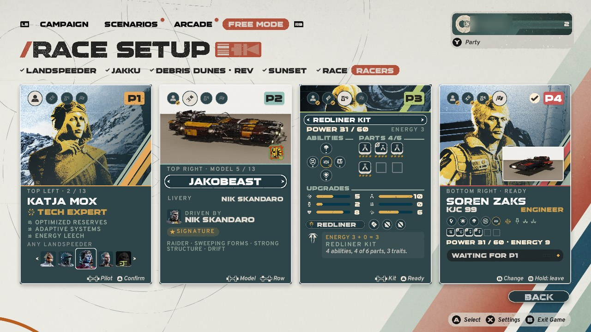

---


## 0.13.1: the stutter is gone - split screen is super fluid now

0.13.0 could stutter badly with 2-4 players, whatever the graphics settings, and the race-start flythrough kept
"reloading". Both are fixed in 0.13.1. The mod's per-frame polls went through an object lookup that costs ~2.5 ms
per call in this game - almost half the game thread went to it; every poll now runs from a cache. Measured on the
same machine, same race, same settings: **2 players 41 → 59 fps, 4 players 54 fps, not one frame over 100 ms** -
it feels like the vanilla game again. The intro camera guard that snapped the view back to the car once a second
through the whole flythrough now stays out of the intro entirely.

## 0.13.0: play modes, and the split-screen HUD is finally per player

**New (in short):** the FREE MODE page now has three ways to play - **QUICK RACE** (everyone and the AI on the same
tier build: fair races between friends, one difficulty knob), **CUSTOM RACE** (the full setup, with *Opponents: match
the players*) and **GALAXY RUN** (a 2-4 player career-style run: races, credits, a shop between events). RESTART RACE
in the pause menu now relaunches the same race with its AI on every track, and the offline sign-in wait at boot is
skipped.

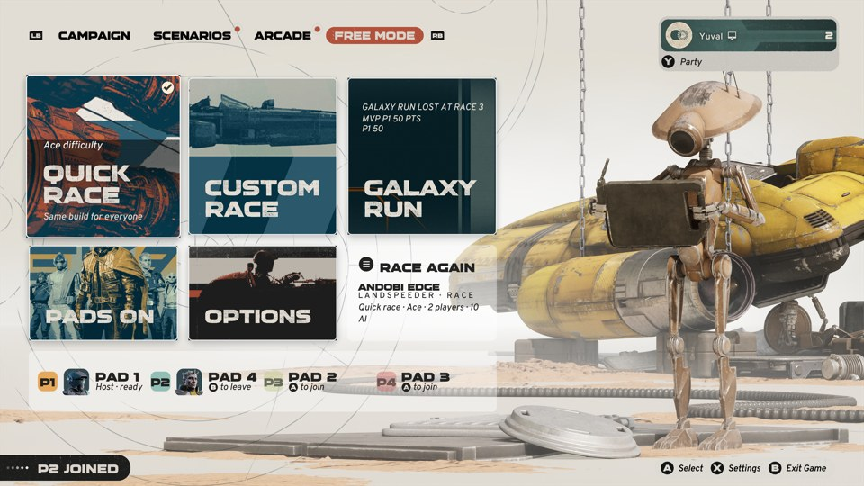

**Fixed (the important part).** The game's HUD assumes one local player; in split screen every view silently showed
player 1's values. 0.13.0 fixes, per player: the **boost (afterburner) bar**, the **two-box ramjet bar** (charges,
then loads to the max - and shows the overheat up to the explosion), the ramjet **screen tint** (only the firing
player's view, no global recolour), **P1's chase camera** (it sat rigid on the car's back until the first crash),
**P1's camera stick** after an earlier wreck (stale spectate controls leaked into the next race), and the **race
audio** no longer goes quiet for everyone when player 1 is out while others still race. Also: one podium hologram and
your own placement on the finish screen, no QUIT GAME flash on B, and P1's B can recover a critical malfunction. **0.13.1:** holding the ramjet into the overheat turns that player's own view red - the "stop accelerating" warning - and back when they let go; blue while it fires. Only that player's screen.

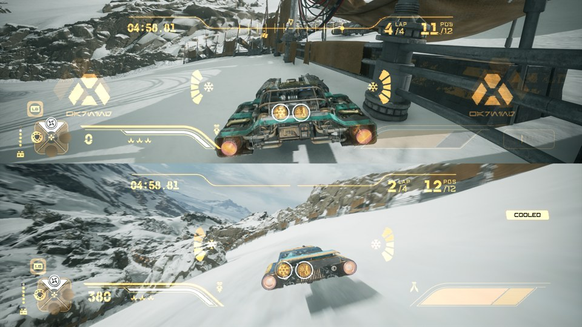
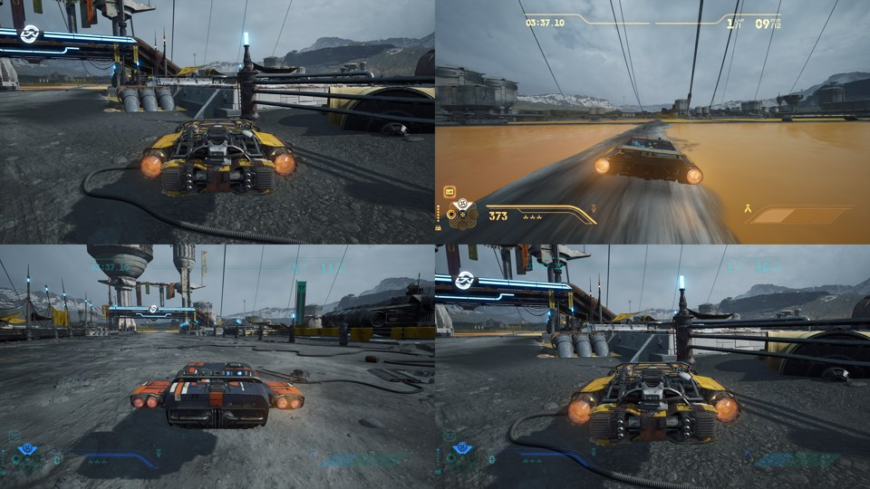

## Screenshots

### 1. The FREE MODE tab

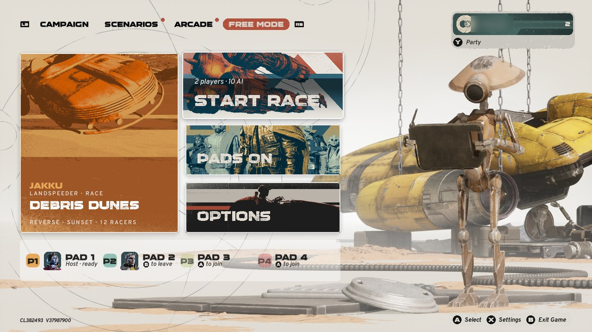

**The FREE MODE tab is drawn like the game's own tabs** (new in 0.12.0). Four posters: the **RACE** card shows the race
START RACE will run (here Jakku, Debris Dunes: *LANDSPEEDER · RACE*, *REVERSE · SUNSET · 12 RACERS*; before the first
choice it reads *CHOOSE RACE*). **START RACE** says who races (*2 players · 10 AI*) or why it cannot start yet.
**ADD PLAYERS** turns the friends' pads on (here already *PADS ON*). **OPTIONS** holds the settings. Under them, the
**players strip** has one cell per pad: the P-tag in the player's colour, the head of the pilot that pad picked last,
and what the pad can do (*Host · ready* for P1, *(B) to leave* for P2, *(A) to join* for pads 3 and 4). Messages show
for 5 seconds in a pill at the bottom left.

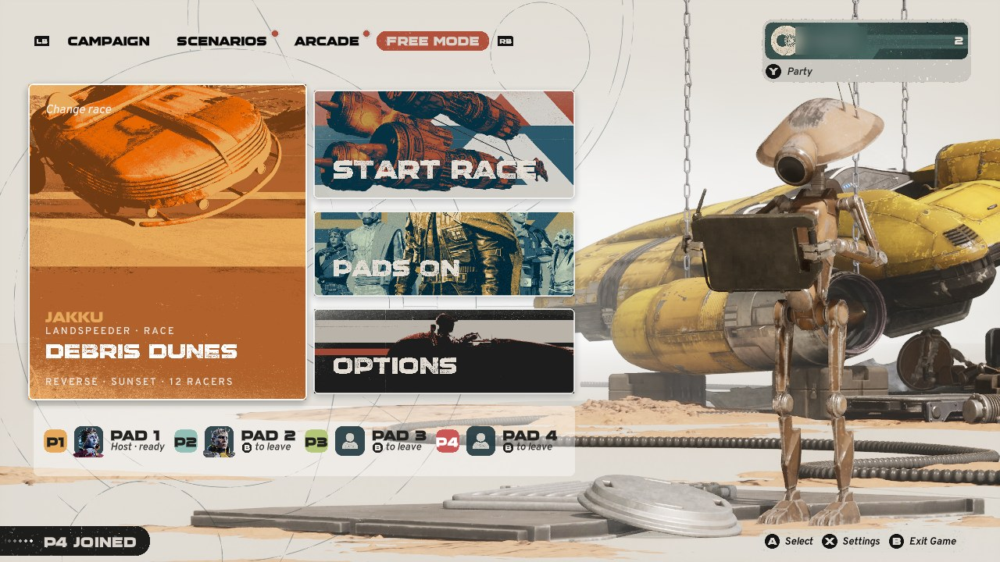

**Four players joined** (the pill: *P4 JOINED*). Every guest's cell reads *(B) to leave*; a pad that has not picked a
pilot yet shows the player icon instead of a head. The focused RACE card offers *Change race*.

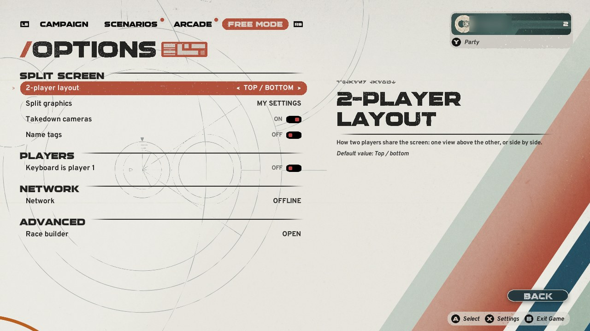

**OPTIONS** (new in 0.12.0) holds what were rows on the old page, as a settings list in the game's look: SPLIT SCREEN
(2-player layout, split graphics, takedown cameras, name tags), PLAYERS (keyboard is player 1), NETWORK (offline, host
or join; a second row then starts hosting or connects) and ADVANCED (*Race builder*: the game's own race builder,
formerly the ADVANCED: DEV RACE BUILDER row). The right column explains the focused row and, for a setting, gives
its default (*Default value: Top / bottom*). Left / right change a value; **B**, Backspace or **BACK** returns to the
posters.

### 2. Race setup (steps 1-4)

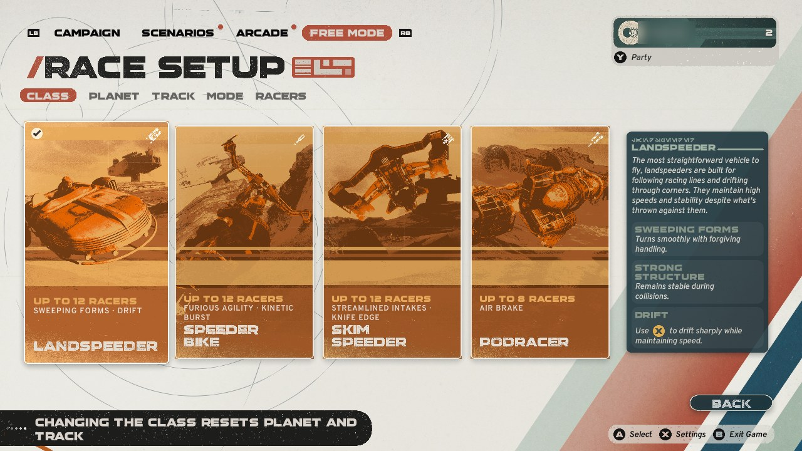

**Step 1, CLASS:** under the **/RACE SETUP** title, a step row that turns each choice into a ticked value as you go,
and BACK at the bottom right. Four class posters (landspeeder, speeder bike, skim speeder, podracer) with the grid size
and the class traits, and a panel built from the game's vehicle-select parts with the focused class's description and
traits (DRIFT: *Use (X) to drift sharply while maintaining speed*). The pill notes that changing the class resets
planet and track.

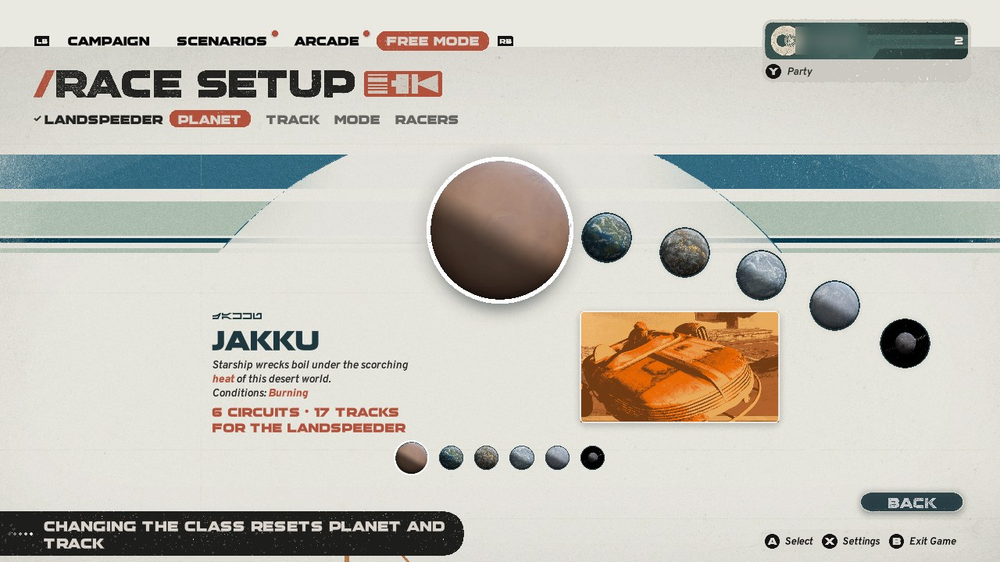

**Step 2, PLANET:** the campaign's planet arc, a row of planet discs to pick with, the planet's description and its
circuit and track count for the class (*6 CIRCUITS · 17 TRACKS FOR THE LANDSPEEDER* on Jakku), and the planet's Arcade
art for that class where the planet video box used to be.

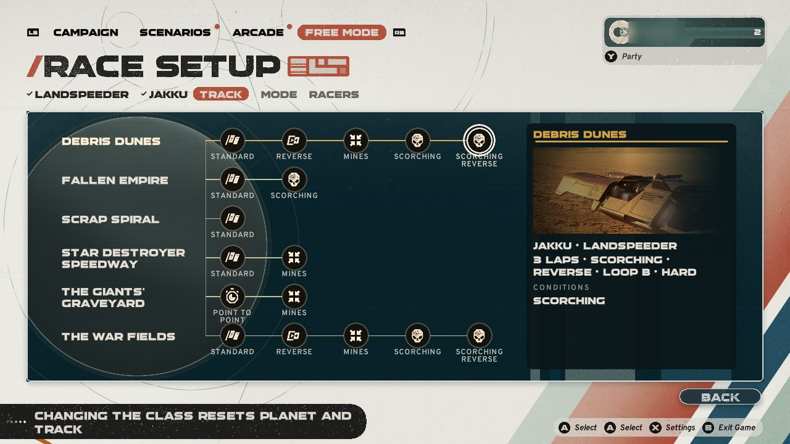

**Step 3, TRACK:** the game's run map of the planet in one frame: one row per circuit, one node per variant (standard,
reverse, mines, scorching, point to point...), and a card with the laps, the variant and its conditions (*3 LAPS ·
SCORCHING · REVERSE · LOOP B · HARD*). Only the tracks the game itself offers in Quick Race and the Arcade are listed:
no debug, prologue or campaign copies.

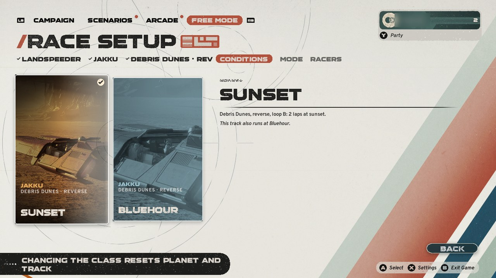

**CONDITIONS** (only for a track with several): one poster per time of day or weather the game offers for the chosen
track, and the race's facts for the focused one (here *Sunset* and *Bluehour*: "Debris Dunes, reverse, loop B: 2 laps
at sunset. This track also runs at Bluehour.").

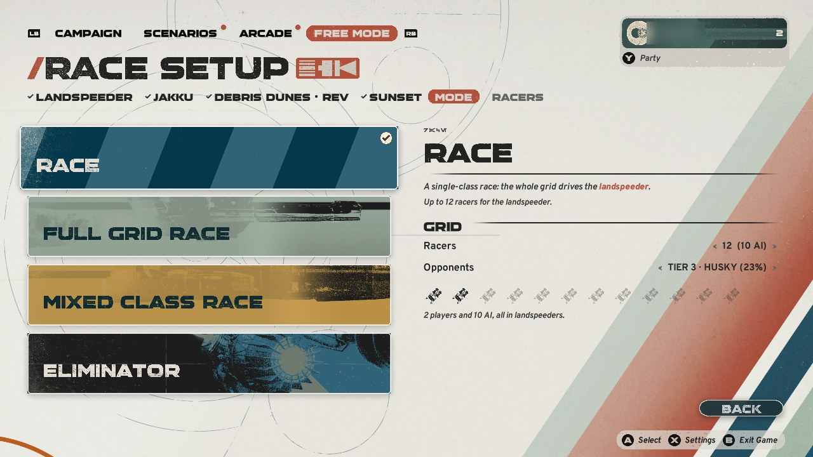

**Step 4, MODE:** four mode posters (race, full grid race, mixed class race, eliminator) with the focused mode's
description, and two GRID rows. **Racers** is the grid size with its AI count (*12 (10 AI)*; up to 12 speeders or 8
pods; *Set by the game* for the modes with a grid of their own). **Opponents** is back in 0.12.0: the AI's strength,
from *TIER 1 · MASTIFF (0%)* (the default: AI without abilities or parts) to *TIER 6 · WHIPPET (58%)*, here *TIER 3 ·
HUSKY (23%)*; pods have no tier (the row reads *Standard*). Under the rows, the grid as a strip of silhouettes
(humans solid, AI dimmed): *2 players and 10 AI, all in landspeeders*.

### 3. RACERS: pilot, then vehicle, then perks (step 5)

Every player gets **the same card**, drawn like the game's Scenarios posters, and moves through **PILOT → VEHICLE →
PERKS → READY** with their own pad: D-pad up/down = row (the top row is the stage icons: left/right there switches
stage), left/right = change, A = next or open a picker, B = back (a guest holds B to leave). **A, A, A** from a fresh
card is the quick path to READY with the pilot's signature vehicle and style kit. Picks are remembered per pad and
come back after a restart.

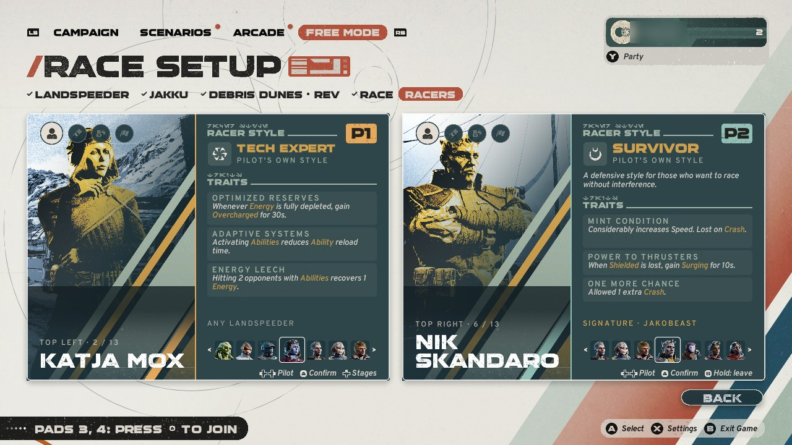

**PILOT:** the pilot's poster art, the racer style (Tech Expert for Katja Mox, Survivor for Nik Skandaro: *PILOT'S OWN
STYLE*) with its three traits, the signature vehicle (*ANY LANDSPEEDER*, *SIGNATURE · JAKOBEAST*) and the roster of
heads. The line above the name says where that player's view will be in the race and the pilot's place in the roster
(*TOP LEFT · 2 / 13*: four pads were connected for this shot, so the race has four views). The four icons at the top
of each card are the stages; the pill tells pads 3 and 4 how to join.

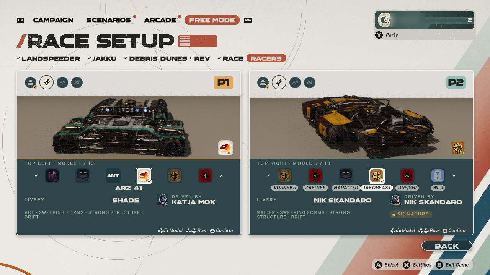

**VEHICLE:** a live 3D render of the pick in a studio, the manufacturer badge, the game's own model name (*ARZ 41*,
*JAKOBEAST*; in the game's language) with a row of model tiles to switch models, the LIVERY, DRIVEN BY with the pilot's
head, the class traits, and a SIGNATURE chip on the pilot's own vehicle.

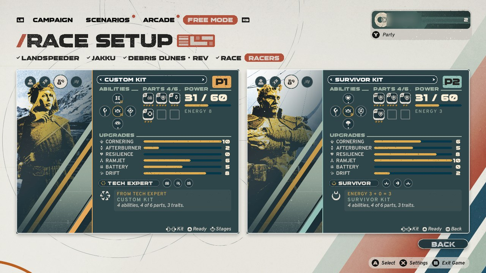

**PERKS:** the whole kart on one board: the kit (*SURVIVOR KIT*; P1 edited theirs, so it is a *CUSTOM KIT*, *FROM TECH
EXPERT*), the four d-pad abilities laid out like the race HUD with the crash ability in the middle, 4 of 6 part slots
with their tier pips, **POWER 31 / 60** and ENERGY, the six upgrade bars (cornering, afterburner, resilience, ramjet,
battery, drift) at their levels, the racer style with its traits, and a detail card for the selected slot. A on a slot
opens a picker with every item of that category, with tier pips and the game's description.

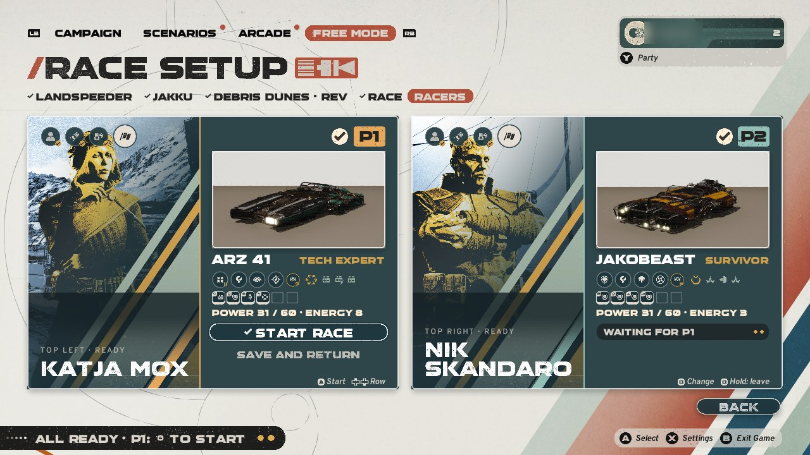

**READY:** the pilot's poster with a check badge by the P-tag, a still render of the vehicle, the model and style, the
complete loadout in two rows of icons and POWER / ENERGY. P1's card offers **START RACE** (with a tick once everybody
is ready) and SAVE AND RETURN; P2's card reads *WAITING FOR P1*, the pill *ALL READY · P1: (A) TO START*. With mouse +
keyboard, START RACE and SAVE AND RETURN move to the bottom right next to BACK, and P1's card shows a READY pill.


**Four players, one per stage:** P1 on PILOT, P2 on VEHICLE, P3 on PERKS (*REDLINER KIT*) and P4 READY, *WAITING FOR
P1*. With four players the cards are at their narrowest: VEHICLE switches models in one title row (*JAKOBEAST* between
two arrows) instead of the row of tiles.

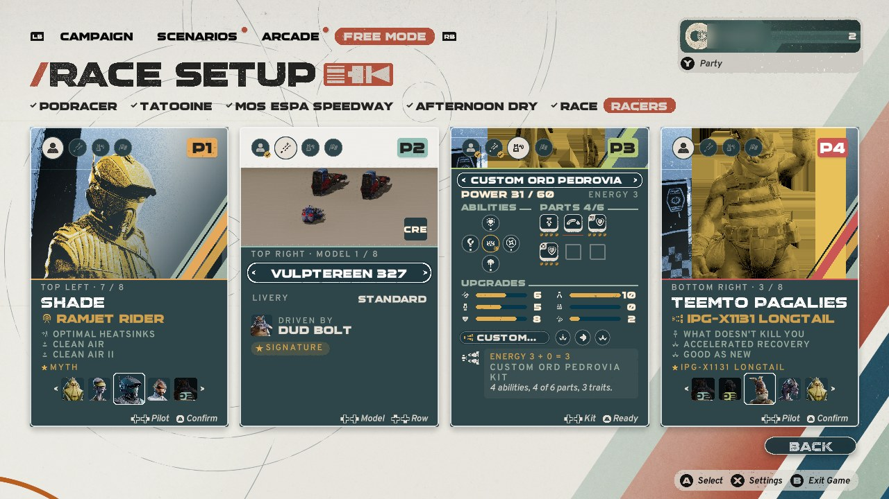

**Podracers (Tatooine, Mos Espa Speedway)** use the same cards. The eight pod pilots have their own racer styles and
signature pods (Shade: *RAMJET RIDER*, *MYTH*; Teemto Pagalies: *IPG-X1131 LONGTAIL*), the pods carry their own names
(*VULPTEREEN 327*, driven by Dud Bolt), and the pod kits load like the speeder kits (P3: the *CUSTOM ORD PEDROVIA*
kit, named after Gasgano's pod). For pods the sixth upgrade is AIR BRAKE, and items that need a ramjet are hidden: pods
have none.

### 4. In the race


**Each player races exactly what they picked:** pilot, vehicle, upgrade levels, abilities, crash ability and parts are
written into that player's build when the race launches, the traits are applied at the start, and everything is
checked again in the race. Each view's ability cluster (bottom left) shows that player's own abilities. (The two lower
views are test pads that were connected but never joined: they race as AI-driven players. START asks twice when that
would happen.)


**Results.** No AI racer uses a human's pilot: an AI that had your pilot gets another one, with its own car **and its
own name**. **P1 can press CONTINUE on this screen**: the game gives it to the last local player, so P1's pad used to
do nothing here.

### RESTART RACE in the pause menu

| | |
|---|---|
| 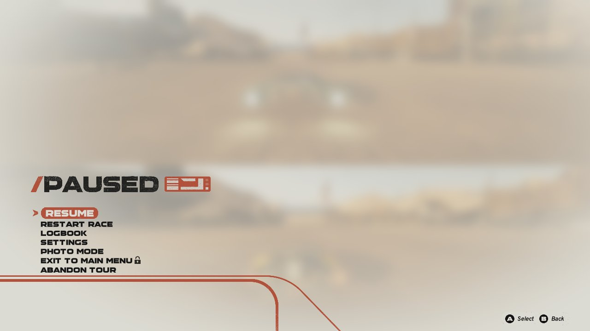 | 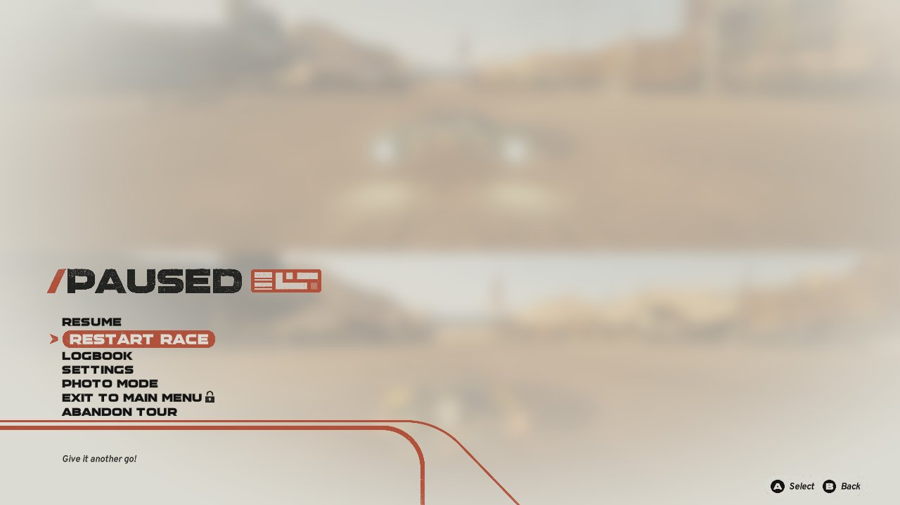 |
| **RESTART RACE sits right under RESUME.** It is the game's own Retry row with the game's own "Restart Race" text, so it looks and sounds like every other row. All rows stay usable: moving the rows down used to leave them grey and the D-pad stopped at the first one. | **The game's description** ("Give it another go!") shows when the row is selected. Every player who paused can use it: P1 directly, a guest through the menu bridge (its A presses the row it has selected). |
| 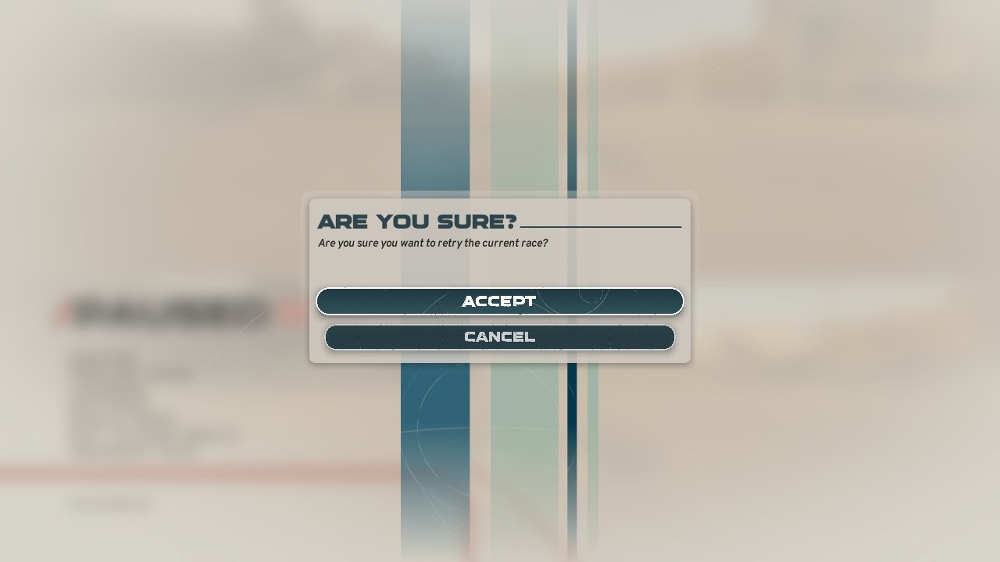 | 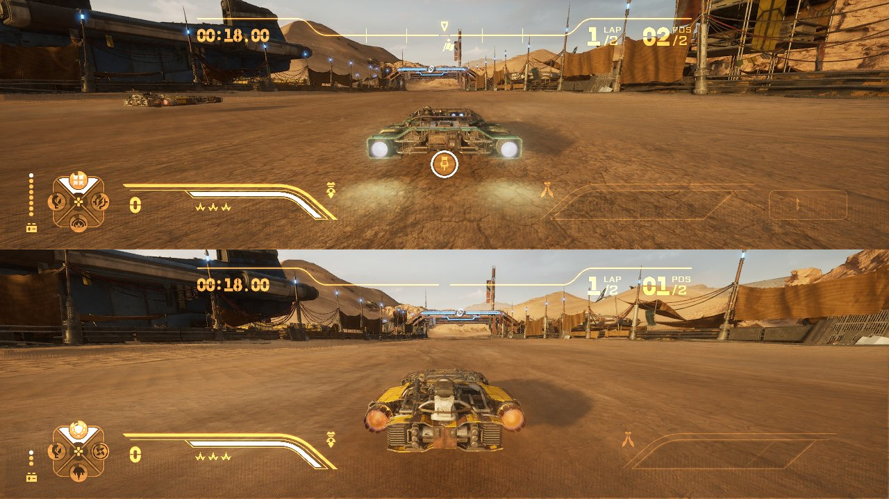 |
| **A asks the game's own question** (ACCEPT / CANCEL). CANCEL goes back to the pause menu, nothing happens. B does not close this dialog for P1 (the game's dialog has no B shortcut): CANCEL is one D-pad press away. | **ACCEPT starts the same race again**: same track and grid, the timer, laps and positions reset, each player's pilot, vehicle, abilities, parts and traits applied again. Tested from P1's pause and from P2's pause, three restarts in a row. |

Only offered in an offline race SWGRCouch started (FREE MODE); never online, in the campaign or arcade, or on a network
client. Settings: `PauseRestart*` in `docs/REFERENCE.md` §7.2 (`PauseRestart = false` removes the row).

**Guests' pause menus on the current game build.** A guest could move through its own pause menu but its A selected
nothing (always after a restart; the game's own seamless travel leaves the guest's menu input dead). The menu bridge
now presses the row the guest has selected, its B resumes or leaves Settings, and after a restart its A also works on
Settings rows (`MenuBridgeGuestPauseMenu`, V-MB-10).

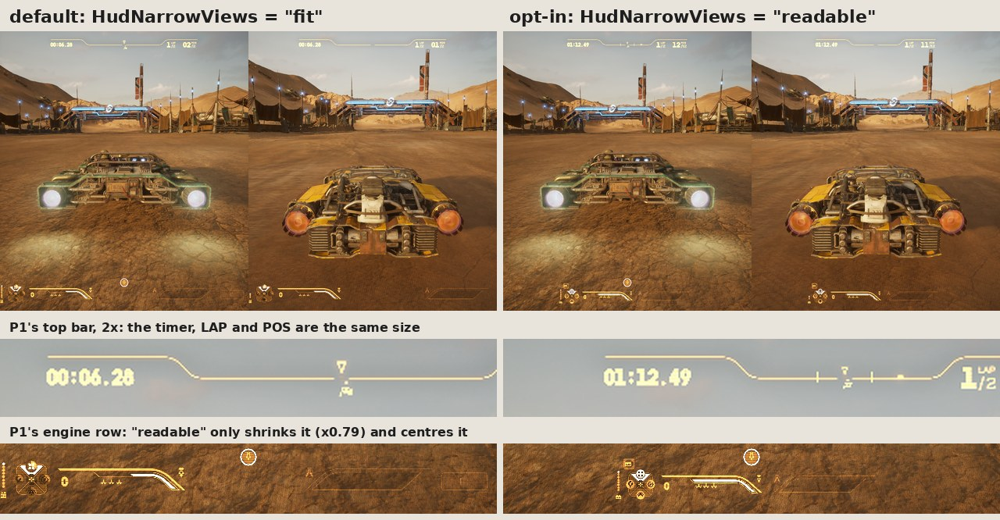

**HUD in half-width views: measured, not worth it.** The same race restarted once in each mode (2 players side by
side): the opt-in `HudNarrowViews = "readable"` layout does not make the timer, lap and position any bigger. It only
pulls the top bar together and shrinks the engine row. The default stays as in 0.10 (left); the narrow layout stays
available as an opt-in if you prefer it on your TV (`docs/REFERENCE.md` §7.2).

### 5. The 0.11 look

Prefer the old pages? `UiStyle = "classic"` in `config_user.lua` brings back the 0.11 FREE MODE rows, the 0.11 RACE
SETUP frame and the 0.11 RACERS cards (`cards.lua`); the new player colours stay (see *Configuration*). The Opponents
row is part of the new MODE step only: with the classic pages, races use the `OpponentTier` saved in `settings.txt`.

---

## What's new in 0.13.0

- **New FREE MODE page: three ways to play, one poster each.** The tab now shows **QUICK RACE**, **CUSTOM RACE** and
  **GALAXY RUN** on top, **ADD PLAYERS** and **OPTIONS** below, and a **START card** that says what the pad's
  **Start** button does right now: *RACE AGAIN* (the last race, in the mode you played it), *NEXT RACE* between
  Galaxy run races, or *START RUN*. A tick marks the mode Start plays.
  - **QUICK RACE** (the default) for playing with friends: nobody builds anything. Each player only picks
    a pilot and a vehicle (or Y for a surprise); there is no PERKS step. One **Difficulty** for the whole race
    (RACE SETUP > MODE: ROOKIE, CADET, PRO, ACE, VETERAN, LEGEND = tiers 1-6) gives **the players and the AI the
    same build**: the same upgrade levels, abilities and crash ability, no traits. The racer cards say so
    ("PRO · TIER 3, SAME AS THE AI").
  - **CUSTOM RACE**: the full per-kart builds, as before. The *Opponents* row gains **MATCH THE PLAYERS**
    after TIER 6: the AI get the players' average upgrade levels, so a maxed group meets maxed opponents.
  - **GALAXY RUN**: the career below. **Right** on the poster picks 4, 6 or 9 races, **A** starts the run and
    opens RACE SETUP for its first race. QUICK RACE and CUSTOM RACE are locked while a run is on.
  - A on QUICK RACE or CUSTOM RACE opens RACE SETUP in that mode (the *Play mode* row left OPTIONS).
- **Podracer opponents have a strength now.** The game has no tier builds for pods, so every AI pod raced at
  power 0 against any player build. The mod now writes the build into each AI pod (QUICK RACE difficulty, MATCH,
  and the Galaxy run's rising tiers).
- **No more 10-second SIGN IN STATUS wait** at the main menu (at boot and after every race): with Steam offline the
  game always waited for its login to time out; the mod now lets the menu through at once (*FastBootSignIn*).
- **B on RACE SETUP / OPTIONS goes back without flashing the game's QUIT GAME dialog.**
- **The finish screen of a split race**: one podium hologram instead of one per player stacked on the same spot, and
  P1's own place ("FINISHED · You came 1st") instead of the last player's.
- **RESTART RACE fixed**: the in-place reload brought every racer back except the AI cars, which never spawned
  again. RESTART RACE now goes back to the menu and launches the same race again right away (same track, players,
  builds and grid), with one extra loading screen.
- **GALAXY RUN**, a rogue-style career for 1–4 players (the GALAXY RUN poster, or *OPTIONS > PLAYERS > Galaxy run*:
  4, 6 or 9 races):
  - The next race you start begins the run. Everyone starts on a **starter build** (the pilot's vehicle, two
    abilities, every level at 0, no parts, no traits) and **200 credits**.
  - **Challenges for every player at once.** Besides races, the run offers challenges, each scored for every player:
    **TIME TRIAL** (no AI, fastest race time, everybody must finish), **HOT LAP** (best single lap; a lap in the top
    3 of the field, top 4 for two players, top 5 solo), **BOOST CHALLENGE** (seconds of afterburner burn, ramjet counts double), **TAKEDOWN HUNT**
    (full grid, most takedowns), plus an **ELIMINATOR** and a full-grid **FINAL** you must win (a lost final costs a
    hull point and is raced again). During a challenge each player's HUD shows its counter next to the race timer
    (BOOST 41 S, TAKEDOWNS 2, BEST LAP 34.21); in races it names your **rival**.
  - **Points** by rank among the players (25 / 18 / 15 / 12), **credits** (300 / 220 / 160 / 120, ×1.5 on the
    risky route, +100 for finishing ahead of the rival: the AI that placed best last race), and a **team target**
    per event; a missed target costs one of the team's **3 hull points**, 0 hull ends the run. Fewer players get looser
    targets (solo: 2 places looser and a top-2 final; two players: 1 place looser).
  - **Between races** the GALAXY RUN poster shows the next event and the standings; **Right on it switches the
    route** (A: a race, B: a challenge for ×1.5 credits). **A on it** (or **Start**) opens the racer cards: each player first picks **one free
    reward out of three** (the last player picks out of four; sometimes a **TEAM REPAIR**), then the **shop**:
    perks and a level-cap upgrade for credits, a reroll, and repairs. A **wreck breaks one of your parts** until it
    is repaired in the shop.
  - In a run the PERKS pickers only list what you own and levels stop at your cap. A race left before its end does
    not count. The run is kept in `Mods/SWGRCouch/run.txt` (a quit game continues it) and never touches the game's
    campaign or save. To stop a run: *OPTIONS > Galaxy run*, A twice.
- **Easy builds for friends** on the racer cards: a guest's **Y** (SURPRISE ME) picks a random free pilot, its
  vehicle and a random kit and goes to READY; **X** (COPY P1) gives the guest P1's loadout on their own pilot. P1
  can still start with START AGAIN TO RACE ANYWAY while friends are choosing.
- **P1 wrecked first in a split race**:
  - the other players' race timers kept running (they read `--:--.--` before);
  - every player still racing keeps their pad buttons over the game's menu input layer (that was only done for P1);
  - P1's view no longer stays on the crash camera (the game kept taking the view back).

## What's new in 0.12.0 (since 0.10.1)

0.11 was not released on its own: its features are part of 0.12.0 (last group below).

- **The FREE MODE pages in the game's own look (UI v2)**, drawn with the game's own art, fonts and layouts:
  - **FREE MODE tab**: four posters (RACE card, START RACE, ADD PLAYERS, OPTIONS), the players strip (each pad's tag,
    the head of its last pilot, what it can do) and a status pill for messages.
  - **OPTIONS**, a page of its own: 2-player layout, split graphics, takedown cameras, name tags, keyboard as player 1,
    network and the game's race builder. Each row has a help text; each setting also shows its default.
  - **RACE SETUP**: the /RACE SETUP title, a step row that ticks off each choice, BACK at the bottom right. CLASS,
    CONDITIONS and MODE are posters; PLANET has the planet discs and the planet's Arcade art (no video box); TRACK is
    the run map in one frame.
  - **RACERS cards** drawn like the game's Scenarios posters. VEHICLE shows the game's own model names, in the game's
    language (*ARZ 41*, *JAKOBEAST*), and a studio render. With mouse + keyboard, START RACE and SAVE AND RETURN move
    from P1's card to the bottom right.
  - **Player colours** from the game's planet tones: P1 apricot, P2 teal, P3 lime, P4 Crait red (P-tags, cards,
    players strip, the name tags in the race).
  - The 0.11 look stays one switch away: `UiStyle = "classic"` (see *Configuration*).
- **Opponents (the AI's strength) is back**: RACE SETUP > MODE > **Opponents**, TIER 1 (default) to TIER 6, for speeder
  races. The AI race on that tier's build; every human keeps their own RACERS loadout. 0.10.1 ran every RACERS race on
  TIER 1. Saved as `OpponentTier` in `settings.txt`.
- **Pad B goes back on OPTIONS and in RACE SETUP.** Before the first race the game sends P1's B only to its own QUIT
  GAME? prompt, with ACCEPT focused, where one more A quits the game. The mod now answers that prompt No and goes back
  (`BackPromptAsBack`). On the FREE MODE posters, B is still the game's Exit Game (see *Known issues*).
- **Hot-plugged pads**: a pad switched on while the game runs takes P1 only while P1's own pad is gone (for example a
  Moonlight / Sunshine pad that reconnects). A second pad switched on next to a working P1 pad stays free for ADD
  PLAYERS, and with *Keyboard is player 1* no pad takes P1 (`HotplugPadToP1`).
- **Release defaults**: `Debug = false` and the research probes off (fewer log lines; set `Debug = true` in
  `config_user.lua` for a bug report). A first install keeps UE4SS's console windows off (0.10.1 turned them on):
  `install.sh --console` turns them on, `--quiet-console` off again. `install.sh` names the UE4SS Galactic Racer
  Edition when UE4SS is missing, and warns when it finds UE4SS 3.0.1-1160, which does not boot on the current game.
- From the 0.11 builds:
  - **RESTART RACE** in the pause menu (any player who paused), with the game's own confirm dialog.
  - **Guests' pause menus work on the current game build**: a guest's A selects the row it has selected, its B
    resumes or backs out of Settings, also after a restart.
  - **HUD in half-width views**: an opt-in narrow layout (`HudNarrowViews = "readable"`) was measured and does not
    make the timer, lap and position bigger (see above); the default is unchanged.

### Already in 0.10.1 (new since 0.9.3)

- **FREE MODE**: the SPLIT SCREEN tab is renamed (the mod works for one player too).
- **RACERS step**: pilot, then vehicle, then perks, then ready, one identical card per player; all perks unlocked
  (45 abilities in 8 families + the crash ability, 316 parts in 12 categories, 41 traits, 21 racer styles, 27 kits,
  six upgrade levels); picks saved per pad.
- **In the race**: each human's pilot, vehicle and loadout are applied and verified; AI racers never share a human's
  pilot (car and name included).
- **P1 owns the menus after a race**: the main menu and Settings used to belong to the last guest after a split race.
- **P1 can continue the results screen** (an invisible button with P1's focus catches P1's A).
- **Crash fix**: keyboard keys could crash the game (UE4SS runs keybinds on another thread); keys are now queued and
  run on the game thread. Verified with 160 rapid key presses.
- **Game tracks only**: the race setup lists what the game itself offers (no debug, prologue or campaign copies).
- **Both game builds**: the native input filter recognises the launch build and the October hotfix. With 0.9.3 on the
  updated game the filter did not install, so **both cars obeyed pad 1**; this fixes it.
- CLASS step trait texts no longer show raw markup; the installer keeps your UE4SS console setting on a re-install.

## Status: tested live

| Feature | 1 player | 2 players | 3 players | 4 players |
|---|---|---|---|---|
| UI v2 pages: FREE MODE tab, OPTIONS, RACE SETUP, RACERS cards | ✅ | ✅ | ✅ | ✅ |
| Pad B goes back on OPTIONS and RACE SETUP (the game's QUIT GAME? prompt answered No) | ✅ | ✅ | — | — |
| `UiStyle = "classic"` (the 0.11 pages) | ✅ | — | — | — |
| Opponents: TIER 1 and TIER 4 races, 5 launches in a row from RACE SETUP | — | ✅ | — | — |
| A pad switched on next to a working P1 pad stays free (P1 keeps its pad) | ✅ | — | — | — |
| FREE MODE tab, race setup, game-only tracks | ✅ | ✅ | ✅ | ✅ |
| RACERS step (pilot, vehicle, perks, pickers, ready) | ✅ | ✅ | ✅ | ✅ |
| Loadouts applied and verified in the race | ✅ | ✅ | — | — |
| Each pad drives only its own car (input filter, current game build) | — | ✅ | ✅ (0.9) | — |
| P1 owns the menus after a race; P1 continues the results | — | ✅ | — | — |
| RESTART RACE from the pause menu (P1 and a guest), loadouts applied again | not tested yet | ✅ | — | — |
| A guest's own pause menu, Settings and the confirm dialog | — | ✅ | — | — |
| Keyboard keys (crash fix) | ✅ | ✅ | — | — |
| Podracers in the RACERS step | ✅ | ✅ | — | ✅ |
| A full podrace with loadouts, network races | not tested yet | | | |

The UI v2 pages were checked at 1280x720, 1920x1080, 3840x2160 and 1280x800 (16:10). English, German and French were
checked from a game start in that language. Japanese, Chinese (Simplified), Korean, Polish, Turkish and Arabic were
switched in a running game: the game's texts on the mod's pages show in those scripts (Arabic right to left), but long
localized track names were not checked that way. Opponents: a TIER 1 race gave the AI power level 0, no abilities and no parts; a
TIER 4 race gave them power level 18 and 2 abilities each (TIER 2: power level 6, 1 ability); both players' own
loadouts were in place in every race.

## Requirements
- **STAR WARS Galactic Racer** on Steam, build CL 382493 (the October 2026 hotfix): 0.12.0 was tested on this build.
  The native input filter also knows the launch build CL 381121, but 0.12.0 was not run on it.
- **UE4SS Galactic Racer Edition** (open beta, 2026-10-08), in the with-UE4SS zip. UE4SS 3.0.1-1160 (the 0.9.0 and
  0.9.1 zips) does not boot on the current game.
- One pad per player (Xbox layout tested; DualShock through Steam Input or Moonlight works).
- Windows, or Linux / Steam Deck with Proton (tested: GE-Proton 11-7 + Steam Linux Runtime 4).

## Install

Download the latest release from the **Releases** page:
- `SWGRCouch-0.13.1-with-UE4SS.zip`: mod + input filter + UE4SS Galactic Racer Edition (open beta, 2026-10-08)
  (easiest, everything included);
- `SWGRCouch-0.13.1.zip`: mod only - no UE4SS, and **without the compiled input-filter DLL** (some sites and
  scanners dislike zips with a DLL inside; see [The input filter DLL](#the-input-filter-dll) - solo play works
  as is, split screen needs the DLL);
- `swgr_inputfilter-0.13.1.zip`: just the compiled `swgr_inputfilter.dll`, to complete the mod-only zip.

### Linux / Steam Deck (Steam + Proton)
```sh
unzip SWGRCouch-0.12.0-with-UE4SS.zip && cd SWGRCouch-0.12.0-with-UE4SS
./install.sh "$HOME/.local/share/Steam/steamapps/common/STAR WARS Galactic Racer"
```
Then set the launch options in Steam (Properties > Launch options): `WINEDLLOVERRIDES="dwmapi=n,b" %command%`.
`install.sh` never deletes anything (edited files get a dated copy first) and keeps your `config_user.lua`,
`settings.txt` and UE4SS console setting. A first install leaves UE4SS's console windows off: add `--console` to turn
the log console and the GUI console on (for a bug report), `--quiet-console` to turn them off again.
`./install.sh --help` lists the other options.

With the with-UE4SS zip, `install.sh` replaces the UE4SS core files such as `dwmapi.dll` and `UE4SS.dll` (a dated copy
first) and keeps your other UE4SS files; `mods.txt` and `UE4SS-settings.ini` get the changes the mod needs. With the
mod-only zip it uses the UE4SS already in the game; without one it stops and names the with-UE4SS zip. If it warns
that the installed UE4SS is 3.0.1-1160, install from the with-UE4SS zip.

### Windows
1. Open `<game>\Griffin\Binaries\Win64\` (the folder with `SWGR-Win64-Shipping.exe`).
2. With the with-UE4SS zip: copy `ue4ss-build\dwmapi.dll` and the `ue4ss-build\ue4ss\` folder there.
3. Copy `SWGRCouch\` into `ue4ss\Mods\` (so you get `ue4ss\Mods\SWGRCouch\Scripts\main.lua`), replacing old files.
4. Copy the `ue4ss_signatures\*.lua` files into `ue4ss\UE4SS_Signatures\`.
5. `ue4ss\Mods\mods.txt` must contain the line `SWGRCouch : 1` (above the last line, `Keybinds : 1`).

**Updating from 0.10.1:** install over it the same way. If your `config_user.lua` sets `CardW`, `CardGap`, `CardH`,
`CardRowW`, `SetupCMapVideoW`, `SetupCMapBackground`, `SetupCMapMapW` or `SetupCMapMapH`, remove those lines: a value
set there also replaces the new layout's own value.

### Check it works
Start the game. `Griffin/Binaries/Win64/ue4ss/UE4SS.log` shows `SWGRCouch 0.12.0 loading` and `modules=46/46`, and the
main menu has a **FREE MODE** tab with four posters. In a race with two pads, the log shows
`native filter loaded: installed=1 reason=ok build=382493`.

## Uninstall
- **Linux / Steam Deck:** remove `WINEDLLOVERRIDES="dwmapi=n,b"` from the launch options: UE4SS and the mod no longer
  load (the files can stay).
- **Windows:** delete or rename `dwmapi.dll` in `<game>\Griffin\Binaries\Win64\`.
- Every file `install.sh` changed has a dated copy next to it (`*.swgrcouch-<date>`). If you ran it with `--prefix`:
  `install.sh --prefix <wine prefix> --net-off` removes the network override, and `--fastboot-ini-undo` turns the
  Epic link setting in `GameUserSettings.ini` back on.
- The Epic link setting in your game profile stays off after an uninstall. To play online again, put back the `Saved`
  folder you copied before the install, with Steam Cloud still off for the game so Steam does not replace it (see the
  warning at the top).

## Play
1. Main menu > **FREE MODE** (LB / RB).
2. Alone: **START RACE**, or A on the **RACE** card (*CHOOSE RACE* the first time) to choose the class, planet, track,
   conditions and mode.
3. With friends: A on **ADD PLAYERS**, then A again within 5 seconds to confirm (the poster then reads *PADS ON*; the
   pads stay on until the game restarts). Each friend presses **A** on their own
   pad; the players strip shows who joined. A guest leaves with **B** (in RACERS: hold B).
4. In RACE SETUP, **B** (or Backspace, or BACK) goes back one step; on CLASS it closes RACE SETUP. In RACERS,
   everybody picks pilot, vehicle and perks, and B steps back a stage. P1 starts when everybody is READY (START RACE is
   on P1's card with a pad, at the bottom right with mouse + keyboard).
5. **OPTIONS** holds the 2-player layout, split graphics, takedown cameras, name tags, keyboard as player 1, network
   and the game's race builder; **B**, Backspace or **BACK** returns to the posters. On the posters themselves, B is
   the game's Exit Game (see *Known issues*). With *Keyboard is player 1*, P1 goes back with Backspace.
6. In the race, Start pauses (the pause menu belongs to whoever pressed it; RESTART RACE is right under RESUME). On the
   results, any player's A continues.

## Test it (and report)
1. Boot: `SWGRCouch 0.12.0 loading` and `modules=46/46`; the FREE MODE tab shows four posters.
2. OPTIONS: change each row, then press B (or Backspace): you are back on the posters, with no QUIT GAME? prompt left
   on screen.
3. A solo race of each class; then 2-4 players. In RACE SETUP, B steps back one step. Try MODE > Opponents on TIER 1
   and on a higher tier.
4. RACERS: change pilot, vehicle and perks with every pad; the quick path A, A, A; START (with a pad on P1's card;
   move the mouse and START RACE / SAVE AND RETURN move to the bottom right).
5. In the race: your own abilities in your own HUD; every pad drives only its own car; pause from P1 and from a guest;
   RESTART RACE.
6. Results: P1 presses A; back in the menu, P1's pad drives the menu and Settings.
7. Keyboard: arrows, Enter and Backspace on the FREE MODE tab, OPTIONS, RACE SETUP and RACERS.
8. Optional: `UiStyle = "classic"` in `config_user.lua`, restart the game: the 0.11 pages.

When reporting, set `Debug = true` in `config_user.lua` first and attach **`Griffin/Binaries/Win64/ue4ss/UE4SS.log`**
(every mod line starts with `[SWGRCouch]`) and any `crash_*.dmp` next to it. The full list of checks with their log
lines is [docs/REFERENCE.md](docs/REFERENCE.md) §9.

## Configuration
Never edit `config.lua`. Create `ue4ss/Mods/SWGRCouch/Scripts/config_user.lua` instead, then restart the game:
```lua
return {
    UiStyle          = "v2",     -- "classic" brings back the 0.11 pages (FREE MODE rows, RACE SETUP frame, cards)
    BackPromptAsBack = true,     -- false: pad B on OPTIONS / RACE SETUP opens the game's QUIT GAME? prompt again
    SetupPlayerFlow  = "cards",  -- "classic" brings back the 0.9 vehicle columns instead of RACERS
    HotplugPadToP1   = "off",    -- a pad switched on later never takes P1 ("front" | "always" | "off")
    SkipRaceIntro    = true,     -- skip the race intro cinematics
}
```
- `UiStyle = "classic"` is the way back to the 0.11 pages if the new ones give you trouble; the new player colours
  stay.
- `BackPromptAsBack = false` leaves the game's QUIT GAME? prompt on OPTIONS and RACE SETUP (the 0.11 behaviour).
- **Opponents** is not a `config_user.lua` key: it is `OpponentTier` (1 to 6, default 1) in
  `ue4ss/Mods/SWGRCouch/settings.txt`, with your other choices (2-player layout, network...). RACE SETUP > MODE >
  Opponents changes it.
- `Debug = true` adds the log lines a bug report needs.

A layout key you set here (`CardW`, `CardH`, `SetupCMapVideoW`...) applies to both looks. Every key is explained in
`Scripts/config.lua`, and most of them in [docs/REFERENCE.md](docs/REFERENCE.md) §7.2; the `settings.txt` keys are in
§7.1.

## Known issues
- **B on the FREE MODE posters is the game's Exit Game.** As on every main-menu tab, P1's B there opens the game's
  QUIT GAME? prompt with ACCEPT focused: choose CANCEL. Only OPTIONS and RACE SETUP turn B into back
  (`BackPromptAsBack`).
- **The action bar at the bottom is the game's.** On OPTIONS and RACE SETUP it still reads *(B) Exit Game*, and
  clicking Exit Game with the mouse there also goes back: to quit the game, return to the posters first. On TRACK it
  shows *(A) Select* twice.
- **Joining**: a guest's A press that joins can also click the poster P1's cursor is on. START ignores it
  (`CardGuestClickGuardMs`, 150 ms); the RACE, ADD PLAYERS and OPTIONS posters, the OPTIONS rows and the
  `UiStyle = "classic"` rows do not yet.
- **P1 crashes out while others race** (0.13.0-dev): the timers, input and P1's view are fixed (see *What's new*);
  the full loss of control two players saw with real pads was not reproduced with the test pads. If it happens,
  a log with `Debug = true` helps (*Test it*).
- With two wrecked guests, both may follow the same AI car.
- Pads that are connected but not joined race as AI-driven players with their own view.
- The game pauses itself after about a minute without any game input from any player (the game's own inactivity
  pause).
- Languages other than English, German and French are only partly checked (see *Status*). A RACERS card text that
  does not fit its box is logged as `text overflow` in `UE4SS.log`: please report those lines with the game's language.
- After changing the game's language while it runs, restart the game: until then the RACE SETUP track names and the
  CLASS description can keep the previous language.

## How it works (short)
- **Players**: guests are extra UE local players, created after ADD PLAYERS and kept until the game exits.
- **Race launch**: the game's own custom-race path, with the grid rewritten in memory. The race launches on the build
  of the chosen Opponents tier; each human's pilot and loadout are written over it and checked again in the race.
- **UI**: the pages are built on `theme.lua` from the game's own textures and fonts and a few of its widgets (the page
  title, pills and panels, the campaign map); every focus target is an invisible game button under the painted look.
  The RACERS cards are drawn by `cards2.lua` (`cards.lua` with `UiStyle = "classic"`) from per-player view models built
  by `racers.lua`. `backprompt.lua` answers the game's QUIT GAME? prompt No on OPTIONS and RACE SETUP and goes back.
- **Input**: a small native DLL (`SWGRCouch/native`, source included) gives each player's car its own pad.
- **Per-player UI**: menus and messages the game makes for one player are re-routed to the right player; P1 gets the
  menus after a race (`feowner.lua`) and a catcher button on screens another player owns (`menubridge.lua`).

Details in [docs/REFERENCE.md](docs/REFERENCE.md).

## The input filter DLL
`swgr_inputfilter.dll` (a small native library, ~30 KB, [source included](SWGRCouch/native/inputfilter/)) is what
gives each player's car its own pad in split screen. Without it the mod still loads and **solo play works**, but in
a split race every pad steers player 1's car.

The mod-only zip (`SWGRCouch-<version>.zip`) ships **without the compiled DLL**, because some download sites and
virus scanners flag any zip with an unsigned DLL inside (a handful of heuristic engines flag this one too - a false
positive: the DLL rebuilds **byte-identical** from the C source in this repo with `lld-link /timestamp`, which anyone
can verify). To play split screen, pick one:

1. **Download it**: grab `swgr_inputfilter-<version>.zip` from the release and put `swgr_inputfilter.dll` into
   `ue4ss/Mods/SWGRCouch/native/` (next to `inputfilter/`); or
2. **Compile it yourself**: `SWGRCouch/native/inputfilter/build.sh` rebuilds the DLL from `inputfilter.c` with the
   system LLVM (`clang`, `lld-link`, `llvm-dlltool`); no Windows SDK is needed; or
3. **Use the with-UE4SS zip**, which ships the DLL in place.

The log line `native filter loaded: installed=1 reason=ok build=382493` (first split race) confirms it is active.

## Credits and licences
- SWGRCouch: MIT (see `LICENSE`).
- [UE4SS](https://github.com/UE4SS-RE/RE-UE4SS): MIT.
- STAR WARS and STAR WARS Galactic Racer are trademarks of their respective owners. No game files are distributed.
