# SWGRCouch: couch split screen for STAR WARS™ Galactic Racer

A fan-made [UE4SS](https://github.com/UE4SS-RE/RE-UE4SS) Lua mod that adds **local split screen for up to 4 players**
to STAR WARS Galactic Racer, with a **SPLIT SCREEN** tab in the main menu, its own race setup and per-player HUDs,
menus and cameras.

> **Status: work in progress (0.9.1), tested with 2 and 3 players.** The game itself is not included. You need a
> legitimately bought copy (Steam). This project is not affiliated with Lucasfilm, Disney or the game's developers. It
> contains no game code and no game assets; the screenshots are captures of the game running with the mod.

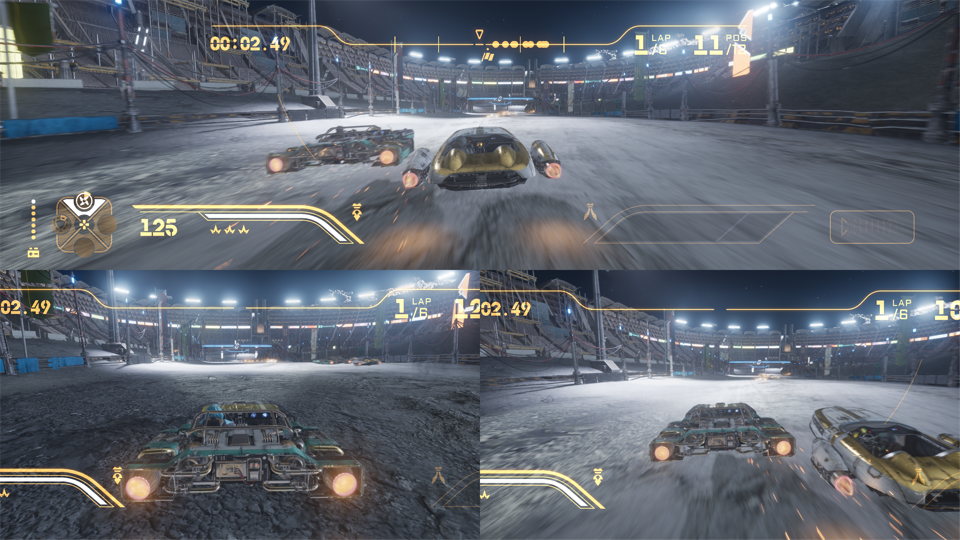

---

## What it does

| | |
|---|---|
| 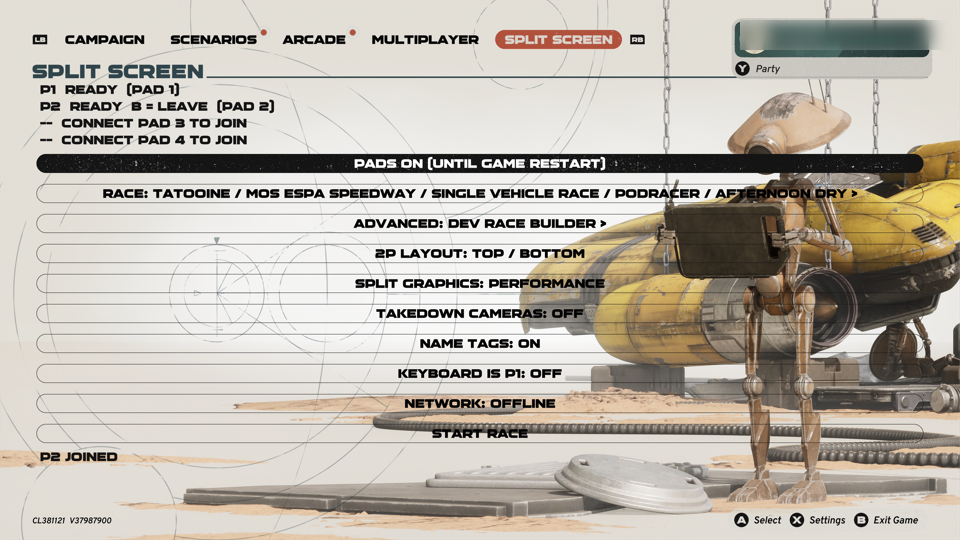 | 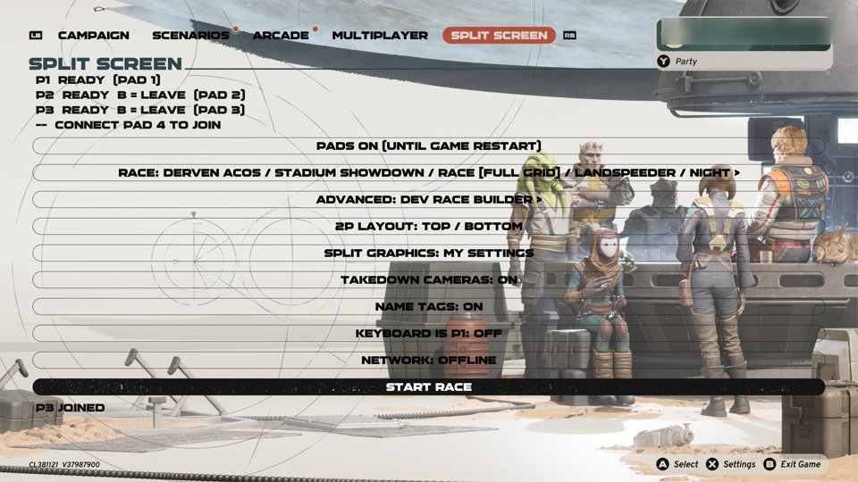 |
| **SPLIT SCREEN tab.** A new tab next to Campaign / Arcade / Multiplayer. **ADD PLAYERS**, then each friend presses **A** on their own pad. | **Up to 4 local players**, each shown with their pad. B (held) leaves. |

### Race setup: class, planet, track, mode, vehicles
| | |
|---|---|
| 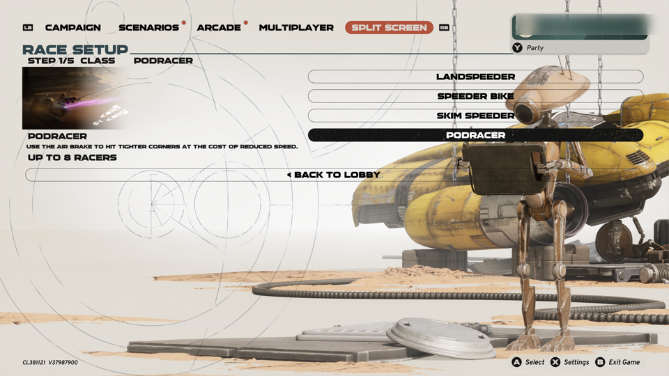 | 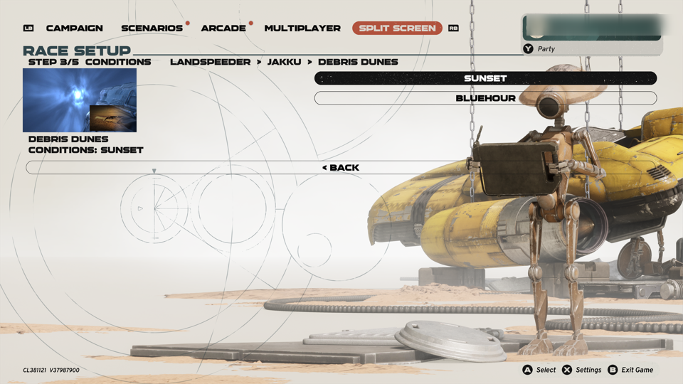 |
| **1. Class**: Landspeeder, Speeder Bike, Skim Speeder or Podracer. | **2-3. Planet and track**, with the planet's arrival video, laps, flags (reverse, mines, point to point) and **conditions** (sunset, blue hour, scorching...). |
| 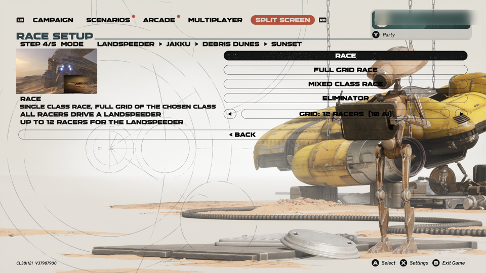 | 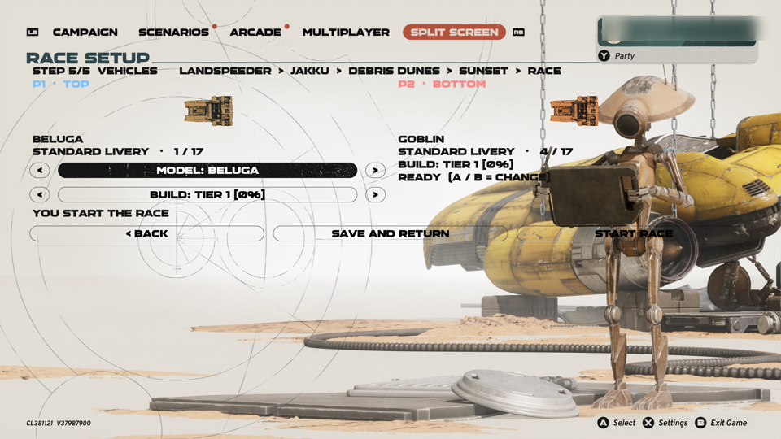 |
| **4. Mode**: race, full-grid race, mixed classes or eliminator, with a **full AI grid** (12 speeders / 8 pods). | **5. Vehicles**: one column per player. Each player picks their own **model and build with their own pad** and marks READY. |

0.9.0 also has campaign-style **PLANET** and **TRACK** steps (still to be tested in the game, off by default). The
PLANET step uses the campaign's own moving planet carousel. The TRACK step is a run map of the planet with one row per
circuit and one node per variant. Turn it on with `SetupCampaignMap = true` (see [Configuration](#configuration)).

### Racing
| | |
|---|---|
| 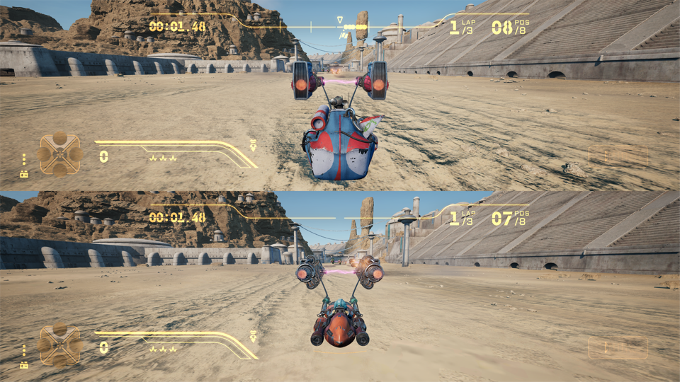 | 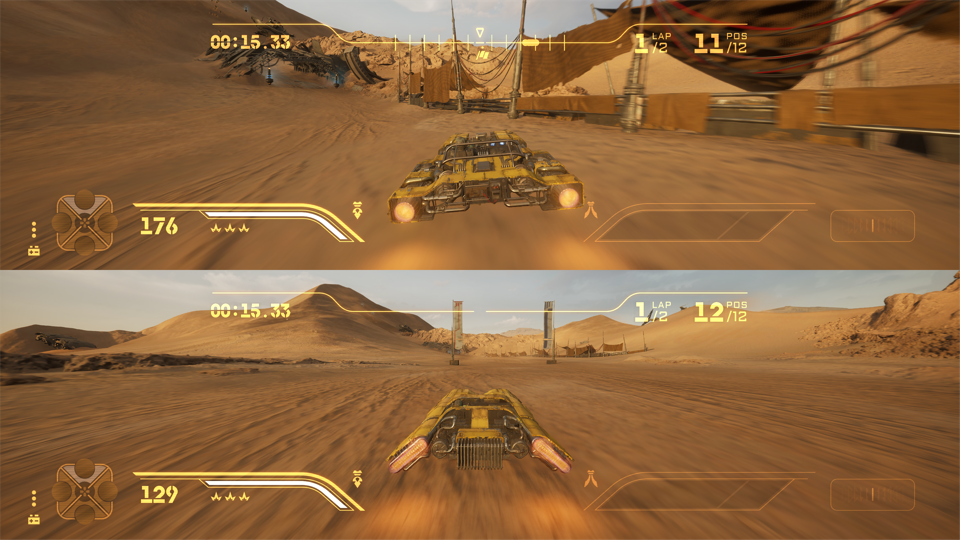 |
| **2 players**: top / bottom (or side by side). Each half has **its own HUD**: lap, position, boost, abilities. | Each car obeys **only its own pad** (a native input filter keeps one pad from driving every car). |
| 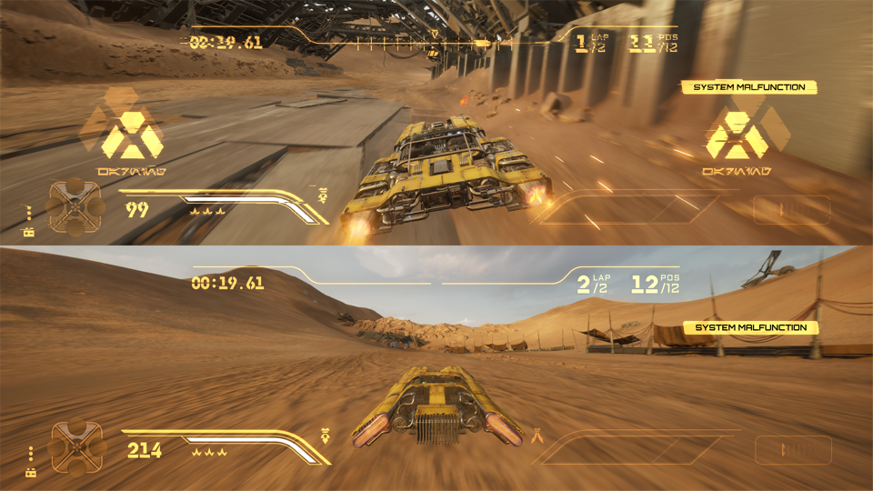 | 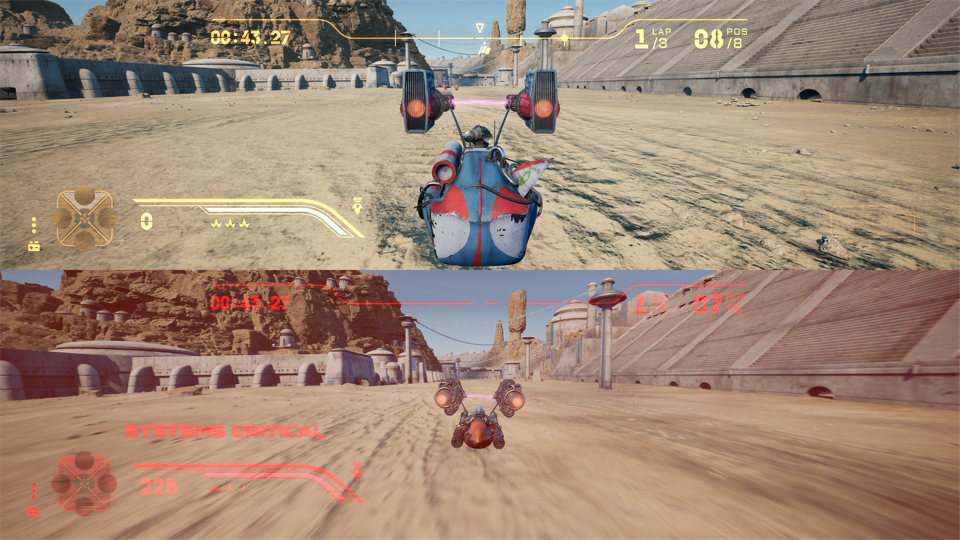 |
| **Messages per player**: "SYSTEM MALFUNCTION", "WRONG WAY", takedowns, perfect landings and the like only show in the view of the player they belong to. | **Danger effects per player**: the red "last life" tint and "SYSTEMS CRITICAL" only affect the player in trouble. |
|  | 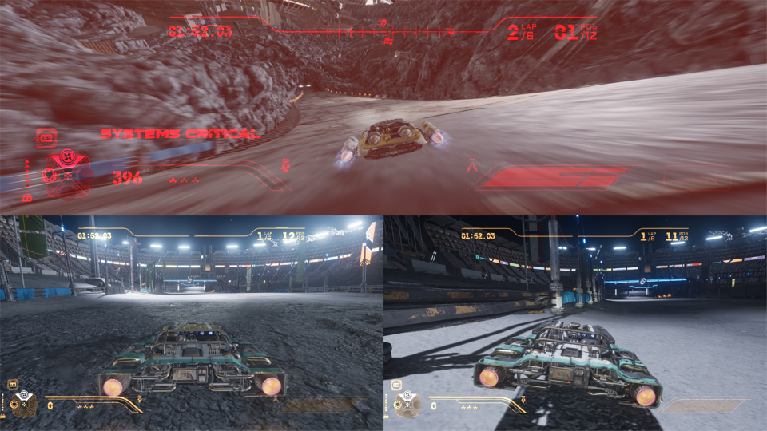 |
| **3 players**: P1 on top, P2 bottom left, P3 bottom right. 4 players: a 2x2 grid. | The HUD scales to the smaller views (timer, lap and position stay fully visible). |
| 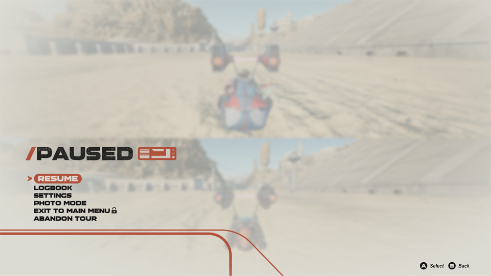 | 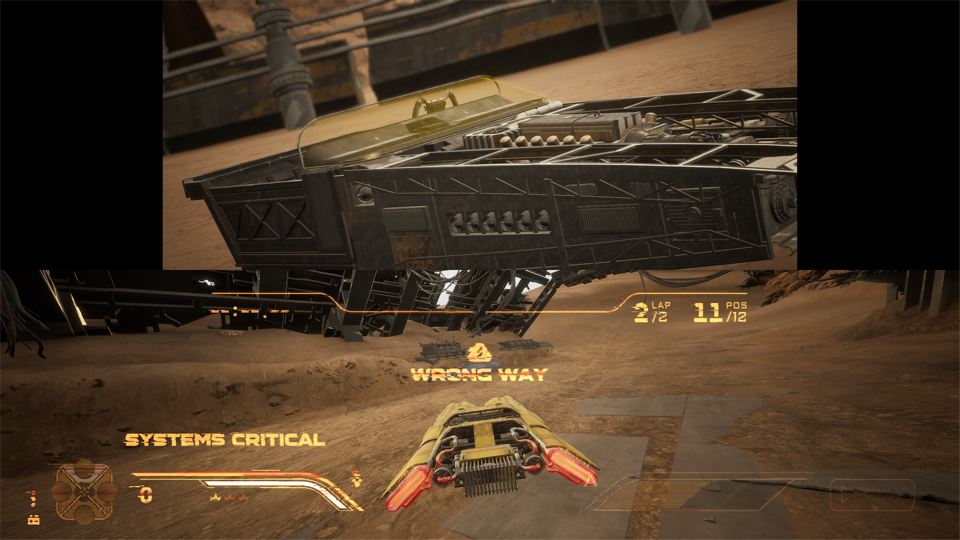 |
| **Pause menu for whoever paused**: a guest's Start opens a pause menu that guest can drive. | Wrecked players **watch an AI racer** instead of a black or frozen view (guests; see known issues for P1). |

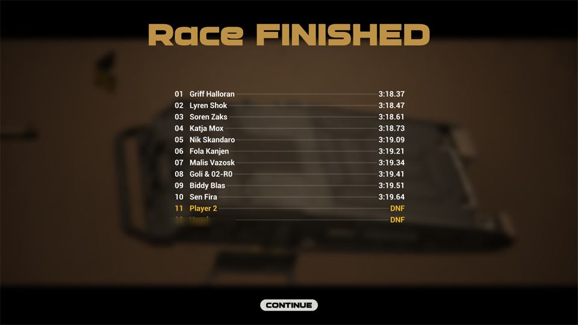

**Results** for everybody, then back to the lobby; START RACE again is a rematch with the same choices.

Other things it does:
- **No-intro boot** (skips the publisher videos and "Press A").
- Engine **ignition** per player for podraces.
- **Name tags** above the human cars.
- Split graphics presets for performance.
- **Hot-plug**: a pad connected later can take P1 (for example a Moonlight / Sunshine streaming pad).
- Experimental **network races** (a self-hosted listen server over IP / WireGuard), untested.

## Status: what has been tested

| Feature | 2 players | 3 players |
|---|---|---|
| Joining, launch, layouts, per-player HUD and messages | ✅ | ✅ |
| Each pad drives only its own car (native input filter) | ✅ | ✅ |
| P1's abilities (LB) and boost switch (R3) during a split race | ✅ (fixed in 0.9.0) | ✅ |
| HUD fits the small views | — | ✅ (0.9.0) |
| Per-player pause menus | ✅ | partly |
| Wrecked guest watches an AI racer | ✅ | ✅ |
| Race setup with per-player vehicles and 3D previews | ✅ | ✅ (previews) |
| Results screen: continue with P1's pad | ⚠️ works for the menu owner | ❌ needs keyboard / mouse (see known issues) |
| Campaign-style planet carousel and run map | not tested yet | not tested yet |
| 4 players, network races | not tested yet | — |

## Requirements
- **STAR WARS Galactic Racer** (Steam, build CL 381121, UE 5.7.4). Other builds may need new UE4SS signatures.
- **UE4SS 3.0.1-1160** (`v3.0.1-1160-g3f4037d2`). The "with-UE4SS" release zip contains it.
- One pad per player (XInput / Xbox layout tested; DualShock through Steam Input or Moonlight works).
- Windows, or Linux with Proton (tested: GE-Proton 11-7 + Steam Linux Runtime 4).

## Install

Download the latest release from the **Releases** page:
- `SWGRCouch-0.9.1-with-UE4SS.zip`: mod + UE4SS 3.0.1-1160 (easiest);
- `SWGRCouch-0.9.1.zip`: mod only, if you already have that UE4SS build.

### Linux (Steam + Proton)
```sh
unzip SWGRCouch-0.9.1-with-UE4SS.zip && cd SWGRCouch-0.9.1
./install.sh "$HOME/.local/share/Steam/steamapps/common/STAR WARS Galactic Racer"
```
Then set the launch options in Steam (Properties > Launch options):
```
WINEDLLOVERRIDES="dwmapi=n,b" %command%
```
`install.sh` never deletes anything: edited files get a dated copy first. `./install.sh --help` lists the options.

### Windows
1. Open `<game>\Griffin\Binaries\Win64\` (the folder with `SWGR-Win64-Shipping.exe`).
2. Copy `ue4ss-build\dwmapi.dll` and the `ue4ss-build\ue4ss\` folder there.
3. Copy `SWGRCouch\` into `ue4ss\Mods\` (so you get `ue4ss\Mods\SWGRCouch\Scripts\main.lua`).
4. Copy the `ue4ss_signatures\*.lua` files into `ue4ss\UE4SS_Signatures\`.
5. Add the line `SWGRCouch : 1` at the top of `ue4ss\Mods\mods.txt`.

### Check it works
Start the game. `Griffin\Binaries\Win64\ue4ss\UE4SS.log` should contain
`SWGRCouch 0.9.1 loading` and `modules=34/34`, and the main menu has a **SPLIT SCREEN** tab.

## Play
1. Main menu > **SPLIT SCREEN** (LB / RB).
2. **ADD PLAYERS** (press it twice), then every friend presses **A** on their pad (`P2 JOINED`...).
3. **CHOOSE RACE** for the race setup, or **START RACE** to use the last race.
4. In the race, every player uses their own pad. Start pauses (the pause menu belongs to whoever pressed it).

Tips:
- Pads are listed in the order the system sees them. Plug them in before starting the game.
- B on a guest's pad makes that guest leave (hold it in the VEHICLES step).

## Test it yourself (and report)

Please test and report what you see. Every check has an id; the detailed list is in
[docs/REFERENCE.md](docs/REFERENCE.md) §9.

1. **Boot**: the SPLIT SCREEN tab exists; `UE4SS.log` shows `modules=34/34`.
2. **Join 2-4 players**; play one race of each class.
3. **During the race**, check:
   - each player's own HUD;
   - abilities (LB and the d-pad), boost (A) and boost switch (R3) for **every** player, P1 included;
   - pause from P1 and from a guest.
4. **Crash out** (lose every life): what does your view show afterwards?
5. **Results**: can P1 continue with the pad?
6. **Campaign screens**: add `SetupCampaignMap = true` to `Scripts/config_user.lua` (see below), open CHOOSE RACE,
   look at the PLANET carousel and the TRACK map, and send screenshots.

When reporting, attach **`Griffin/Binaries/Win64/ue4ss/UE4SS.log`**: every line of the mod starts with `[SWGRCouch]`.
Any crash dump next to it (`crash_*.dmp`) helps too.

## Configuration
Never edit `config.lua`. Instead create `ue4ss/Mods/SWGRCouch/Scripts/config_user.lua`:
```lua
return {
    SetupCampaignMap = true,     -- 0.9.0 campaign-style planet carousel and run map (default false in this release)
    HotplugPadToP1   = "front",  -- a pad connected later takes P1 ("front" | "always" | "off")
    SkipRaceIntro    = true,     -- skip the race intro cinematics
}
```
Every key is listed and explained in [docs/REFERENCE.md](docs/REFERENCE.md) §7.2 and in `Scripts/config.lua`.

## Known issues (0.9.1)
- **Results screen with 3+ players**: P1's pad cannot press CONTINUE (the game gives the screen to the last player).
  Use the menu owner's pad, or keyboard / mouse.
- **P1 crashes out while others race**: P1's view can stay on a frozen crash camera instead of following another
  racer. Guests are fine.
- **Joining**: a guest's A press that joins can also click the row P1's cursor is on in the lobby. Keep P1's cursor
  off START RACE while friends join.
- After a split race, the main menu tabs may show keyboard prompts until P1 uses the pad.
- With 2 wrecked guests, both may follow the same AI car.

## How it works (short)
- **Players**: guests are extra UE local players, created only after ADD PLAYERS and kept until the game exits (the
  engine crashes on removal).
- **Race launch**: the game's own custom-race path, with the grid rewritten in memory.
- **UI**: the game's own widgets, created from Lua.
- **Input**: a tiny native DLL (`SWGRCouch/native`, source included) isolates each player's raw input.
- **Per-player UI**: menus and messages the game makes for one player are re-routed to the right player.

Details in [docs/REFERENCE.md](docs/REFERENCE.md).

## Build the native filter (optional)
`SWGRCouch/native/inputfilter/build.sh` (mingw-w64) rebuilds `swgr_inputfilter.dll` from `inputfilter.c`.

## Credits and licences
- SWGRCouch: MIT (see `LICENSE`).
- [UE4SS](https://github.com/UE4SS-RE/RE-UE4SS): MIT; its licence is in `ue4ss-build/ue4ss/LICENSE` in the
  with-UE4SS zip.
- STAR WARS and STAR WARS Galactic Racer are trademarks of their respective owners. No game files are distributed.
