<div align="center">

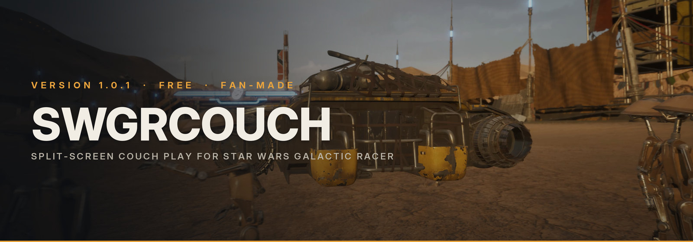

**One screen, up to four controllers.** Race with friends in Free Mode, run a Galactic Grand Prix, or play the game's own campaign together.


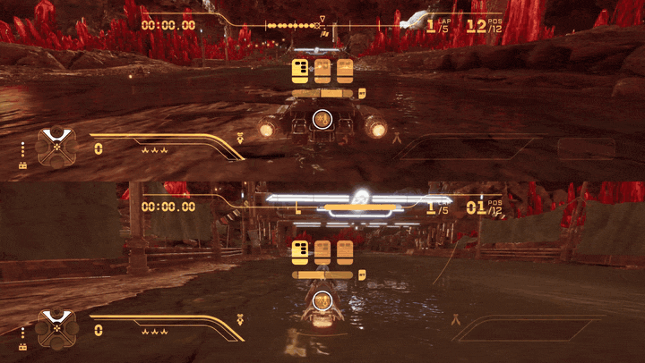

*Two players race on Crait. Each one has their own car, view, HUD and pad.*

**[What you get](#what-you-get)** · **[Couch Campaign](#couch-campaign)** · **[Grand Prix](#galactic-grand-prix)** ·
**[Free Mode](#free-mode)** · **[Install](#install)** · **[Settings](#settings)** · **[Known limits](#known-limits)** ·
**[FAQ](#faq-and-troubleshooting)** · **[Bugs](#found-a-bug)** · **[Credits](#credits)**

</div>

> **Free and fan-made.** You need your own copy of STAR WARS™ Galactic Racer on Steam. Play **offline**, and keep a
> copy of your save before you start: see [Before you play](#before-you-play-offline-only).

<br>

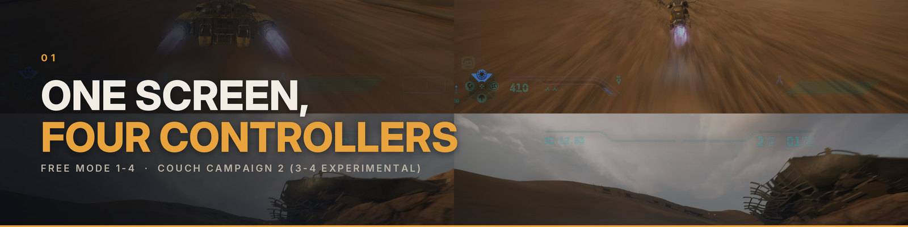

## What you get

| | Free Mode | Couch Campaign |
|---|---|---|
| **Players** | **1–4** on one screen (verified) | **2** verified · 3–4 *experimental* |
| **What you play** | Quick Race, Custom Race, Galactic Grand Prix | The game's real campaign: paddock, run map, acts, bosses |
| **Each player has** | their own pilot, vehicle, loadout, view and HUD | their own vehicle class, racer style, credits, shop, rewards, backer and garage |
| **Split** | top / bottom or side by side for 2, quarters for 3–4 | top / bottom for 2, quarters for 3–4 |

**New in 1.0.2**

- **Works with the 2026-10-22 game update** (CL386500). The update made every pad steer every car in races; the
  input filter knows the new build, and from now on it finds what it needs in a game build it does not know yet by
  itself (`derive=used` in its status), so a future game update should not break split-screen steering again.
- **UE4SS signature fix.** `GMalloc.lua` now reads GMalloc straight from a GMalloc user: the old one pointed past it
  on the new build.
- **Player 2's FAVORS grid shows its cards.** On the couch loadout, player 2's favour grid was an empty panel (only
  the names and texts on the right); it now shows every card like player 1's.
- **Clearer log.** When the input filter cannot patch, UE4SS.log says to update SWGRCouch, and it warns when the old
  SplitScreenMod is switched on (turn it off: the two mods fight over the pads).

**1.0.1**

- **One zip, straight into the game folder.** The new *game-folder* zip has the mod and the input filter DLL laid
  out like the game folder: install UE4SS Galactic Racer Edition, then unzip it into the game folder and play
  ([Install](#install)). It replaces none of your UE4SS settings or other mods.
- **Signed input filter.** The DLL now carries the author's own (self-signed) signature; the certificate and both
  hashes are in [The input filter DLL](#the-input-filter-dll).
- **Steadier couch campaign.** A crash when the game reloads its race HUD is fixed, and so are the backer
  contract focus (player 1's first card is framed from the start), Hibi's shop exits, a wrecked guest's side bet, a
  guest's SPEED on the build panel and player 1's first A on the run map after a guest's rewards.
- **Smoother menus.** RACE SETUP's MODE rows move with Up / Down and change with Left / Right; B on the act replay
  question means NO; the Grand Prix names every racer like the game's own screens.

<br>

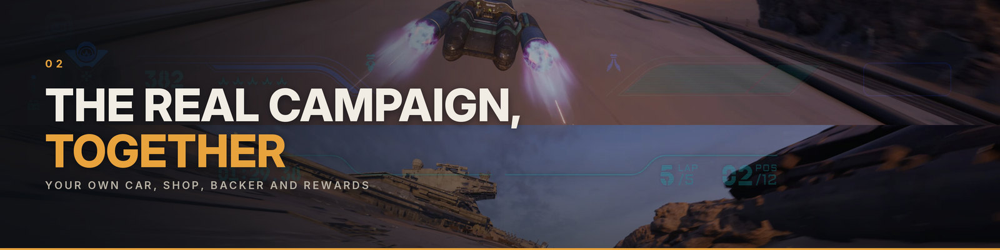

## Couch Campaign

The game's **own campaign**, now for a second player (and, experimentally, a third and fourth). Player 1 plays the
real run: paddock, cinematics, run map and bosses. Every friend races their own car beside player 1 and builds their
own vehicle as the run goes on, in their own part of the screen.

| | |
|---|---|
| 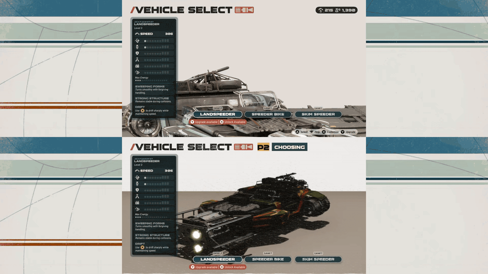 | 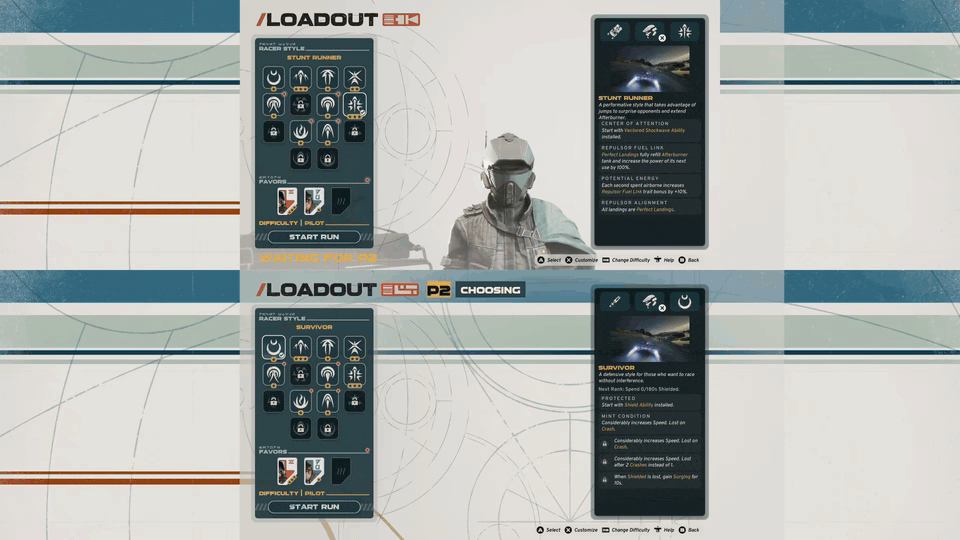 |
| **Your own vehicle.** P2 gets their own VEHICLE SELECT, with the car in 3D, in their half of the screen. | **Your own loadout.** P2 chooses a racer style and favours, then presses READY. START RUN waits until everyone is in. |
| 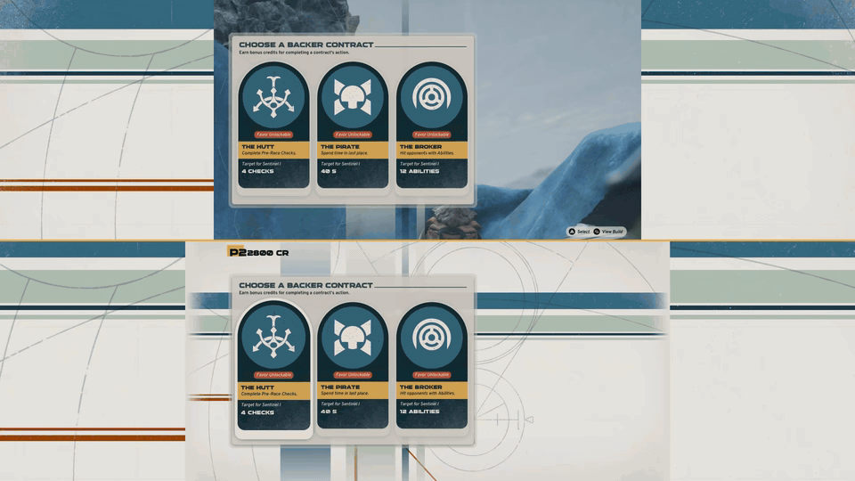 | 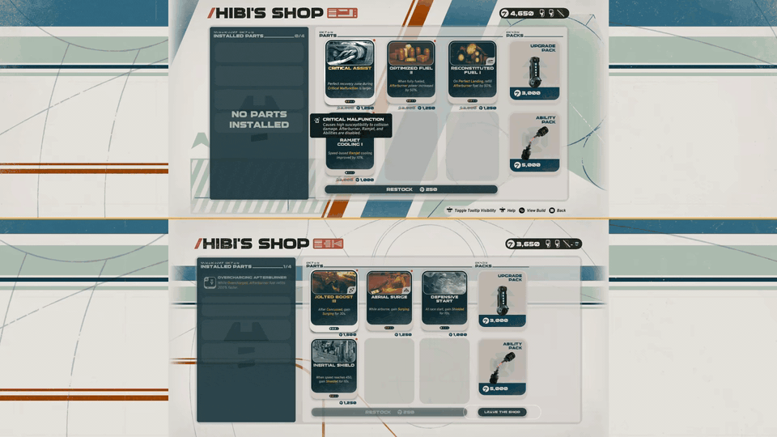 |
| **Your own backer.** Each player signs their own backer contract and gets its signing bonus. | **Your own shop.** P2 gets Hibi's shop with stock for their own class, paid for with their own credits. P1 can't leave until P2 is done. |
| 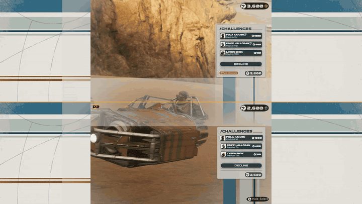 | 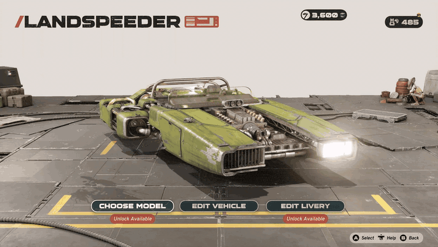 |
| **Your own side bets.** The pre-race CHALLENGES come up in each half: same racers and stakes, your own credits. | **Your own car.** P2's GARAGE is the game's own: model, livery, colours and finish. Player 1's garage is never touched. |
| 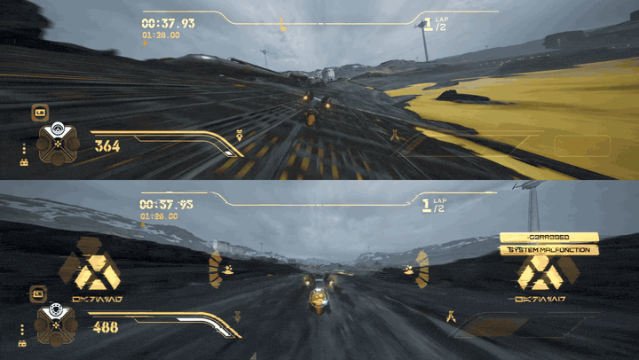 | 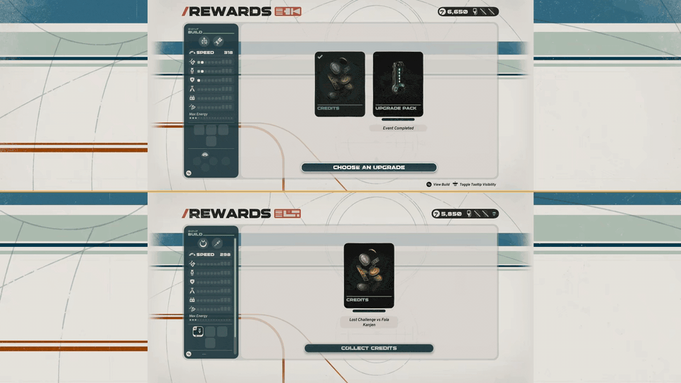 |
| **Field tests together.** Everyone runs the test at once, and each half has its own timer and counter. | **Your own rewards.** P1 picks the game's upgrade while P2 collects their own reward next to it. |
| 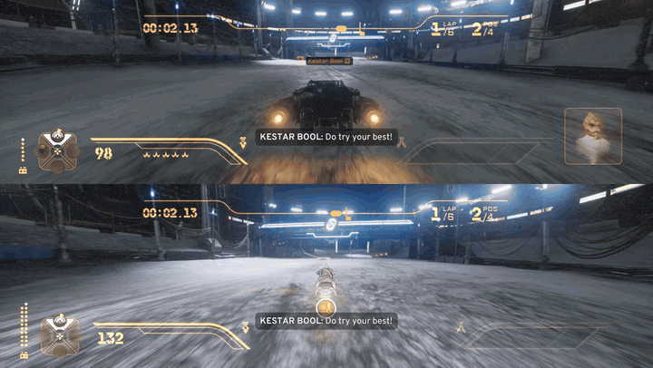 | 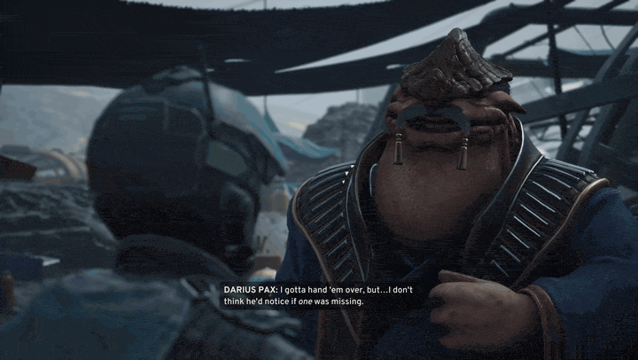 |
| **Bosses, rivals and head-to-heads.** Each player races their own copy of the boss or rival, so nobody is left as a spectator. | **Mysteries.** The same choices come up in P2's half, and the deal applies to P2's own run. Run-wide choices stay P1's. |

- **Your own run, wallet and car.** Each friend has their own credits (earned by finish position), side bets, mystery
  deals, faults after a wreck, and a **GARAGE** with their own model and livery.
- **Seats, not pads.** Progress belongs to P2's seat, P3's seat and so on. If a pad dies, another one can take its
  seat, and after a restart each controller returns to the seat it had.
- **Replay any act** from the COUCH CAMPAIGN page on the CAMPAIGN tab.
- **Needs 2 players.** With nobody joined, CONTINUE or a new run on the COUCH CAMPAIGN page asks first: **BACK TO
  MENU** (for a solo run, use the game's normal CAMPAIGN) or **ADD A SECOND PLAYER** (B too). `CouchSoloPrompt =
  false` in `config_user.lua` starts the run anyway.
- **House rules** for team mystery choices, P1's rewards and the Broker's penalty: see [Settings](#settings).

<details>
<summary><b>Start a couch run, step by step</b></summary>

**Before the first couch run: protect your save.** The game keeps **one campaign run per profile**, and the couch
campaign *is* player 1's run: starting a new run in couch replaces the run you play alone. Quit the game, then copy
the `SaveGames` folder (in the `Saved` folder named in [Before you play](#before-you-play-offline-only)) somewhere
safe; put it back when you want your solo run again (game closed, Steam offline, Steam Cloud off for the game).

1. Main menu > **FREE MODE** > **ADD PLAYERS** (A, then A again to confirm). Each friend presses **A** on their own pad
   until the players strip shows them.
2. Go to the game's **CAMPAIGN** tab (LB / RB) and pick the **COUCH CAMPAIGN** tile: start a new run, CONTINUE, or
   replay an act. The friends stay in. A banner says *COUCH CAMPAIGN: P2 JOINS THE RUN* once the couch rules are on.
3. A new run skips the game's vehicle-tryout prologue race (one car only) and opens VEHICLE SELECT: the screen splits
   and each friend picks a **vehicle class** and **racer style** on their own part (D-pad, **A** = READY). A friend
   who picks nothing gets player 1's class.

</details>

<details>
<summary><b>Who controls what</b></summary>

| Moment | Player 1 | Friends (P2-P4) |
|---|---|---|
| Paddock, cinematics, run map, mysteries, dialogs, results | P1's pad drives everything (P1 walks the paddock) | watch; their buttons do nothing there |
| Races | own car, own split view, own HUD, own pause | the same: own car, view, HUD and pause |
| Boss, rival and head-to-head races | races their own copy of the opponent | each friend races their own copy too |
| Field Tests / Podracer Tests (time trials) | P1's test vehicle | the same test vehicle, all at once, each with their own timer and counter |
| Backer contract | the game's own CHOOSE A BACKER CONTRACT | the same choice in their own area, with its signing bonus on their own credits |
| Rewards after an event | the game's own CHOOSE AN UPGRADE | their own reward area beside P1's: the same kind of reward as P1's round, or SKIP for credits. A friend who **wrecked** is treated like a solo wreck: no finish pay and no reward round (in an eliminator, a wreck that cost the team no token counts as being eliminated at their place); their area shows only what the race still did to their credits (a settled challenge, backer or favour lines), and opens only when there is such a line |
| Shops | the game's shop | the game's shop screen in their own area with the same kind of stock as player 1's: parts for their own class, the **UPGRADE PACK** and **ABILITY PACK** (pick one of the pack's choices) and **RESTOCK**, at the game's prices, paid with their own credits (earned by finish position); **LEAVE THE SHOP** or **B** leaves (an unopened pack waits for the next visit). Like player 1, friends shop at the shops the run visits (Hibi's shop, the scrap dealer); there is no shop on the run map (`CouchMapGuestShop = true`: a friend's **A** on the run map opens their own shop at any time) |
| Their car | the game's own garage (Customize) | their own **GARAGE**: when player 1 leaves his own garage in the paddock, each friend in turn gets *P2: PRESS A FOR YOUR GARAGE* (**A** = their turn in the game's garage, **B** = no thanks): model, livery and colours of their car. It is their car in every race; player 1's garage is never touched (`CouchMapGuestGarage = true`: a *GARAGE* hint on the run map opens a compact garage panel instead) |
| Pre-race CHALLENGES (side bets) | the game's own screen | the same screen in their own area: same racers and stakes, their own credits; A challenges, HOLD A declines |
| Mystery encounters | the game's choices | the same choices in their own area; the deal applies to their own run (run-wide choices stay P1's) |

</details>

<details>
<summary><b>Replay an act, start over, where the friends' progress lives</b></summary>

**Replay an act / start over** (the COUCH CAMPAIGN page, reached from the CAMPAIGN tab's COUCH CAMPAIGN tile): the
campaign's acts are posters next to CONTINUE CAMPAIGN. Any act you unlocked can be played again as a **new run** (A on
its poster), a finished one shows COMPLETED. A run in progress is lost when you start another act: the page asks
first (YES / NO, B = no). OPTIONS > **DELETE ALL COUCH PROGRESS** resets the friends' progress and runs the game's
own campaign reset (acts locked again, a fresh ACT I; vehicle upgrades and logbook unlocks stay). It only works on a
separate couch save profile: a file `.swgr-profile` reading `couch` in the `SaveGames/<account>` folder (written by a
save-profile switcher). On your normal save it is refused, so it can never reset your solo campaign.

The screen splits **top / bottom** with 2 players and in **quarters** with 3-4, like the races. A friend's build
(abilities, parts, traits, upgrade levels) goes onto their car at every next event. The friends' progress is kept by
the mod in `ue4ss/Mods/SWGRCouch/couch-run.txt`, not in the game's save: a new campaign run starts every friend on a
starter build again. Progress belongs to the friend's **seat**, not to his controller: the first friend to join is P2,
the next P3, then P4, whatever pad or USB slot they use. After a restart each controller goes back to the seat it
had last time, whatever order the friends join in (if the controllers come back on other slots, joining in the same
order as before does it); a friend who leaves (hold B) keeps his seat's progress for a rejoin, and a friend whose pad
dies can take over his seat with another pad. A friend's car (their GARAGE) is kept per player seat and vehicle class in
`ue4ss/Mods/SWGRCouch/guest-garage.txt`, across runs. The GARAGE is the game's own full-screen garage, in turns: the
friend's pad drives it (Choose Model, Edit Vehicle, Edit Livery) while player 1's pad does nothing, and player 1's own
garage comes back exactly as it was (`CouchGarageNative = false`: a compact garage panel instead, which offers what
player 1 owns; `CouchGarageUnlocks = "all"` offers everything).

</details>

<br>

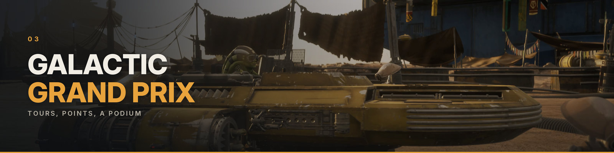

## Galactic Grand Prix

A multi-race tournament on the **FREE MODE** page, for 1 to 4 players and the AI. Every racer scores on one table,
and a podium ends the tour.

| | |
|---|---|
| 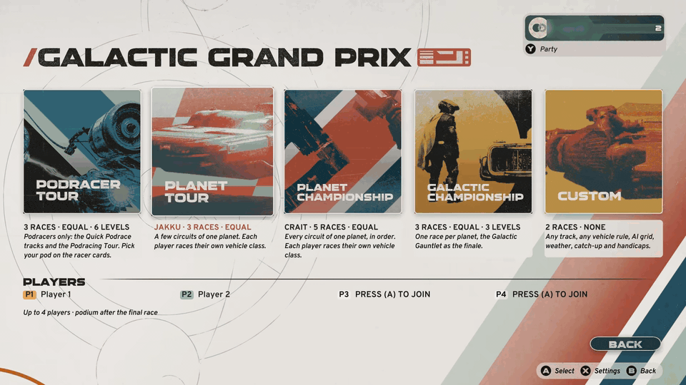 | 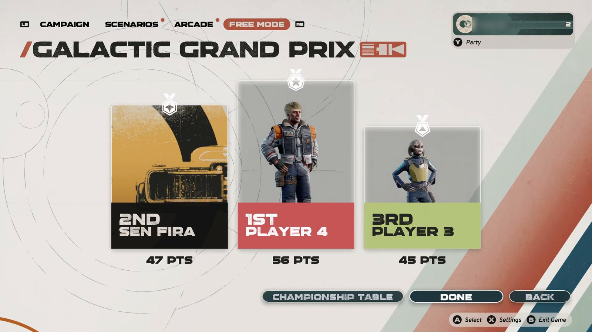 |
| **Pick a tour, set it up.** Choose the planet, the races (or RANDOM), the order, the upgrades, the AI tier and each player's vehicle. | **Race it to the podium.** Between races the page shows the last finish, the championship table and NEXT RACE. |

- **Five tours:** **Podracer Tour**, **Planet Tour**, **Planet Championship** (every circuit of one planet),
  **Galactic Championship** (a tour of the galaxy that ends on the Galactic Gauntlet) and **Custom** (any track, any
  vehicle rule, the most options).
- **Points for everyone:** 25, 18, 15, 12, 10, 8, 6, 4, 2, 1 for the first ten, players and AI alike.
- **Fair or not, your call:** with EQUAL upgrades every player spreads the same number of upgrade levels on the
  racer cards (3 to 15), or NONE for stock cars.
- The tour is kept by the mod in `ue4ss/Mods/SWGRCouch/gp.txt`, never in the game's save.

<br>

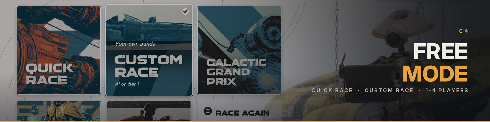

## Free Mode

A **FREE MODE** tab on the main menu, drawn in the game's own style. Pick a way to play, add pads, and go.

| | |
|---|---|
| 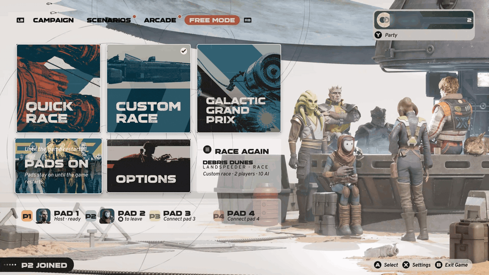 | 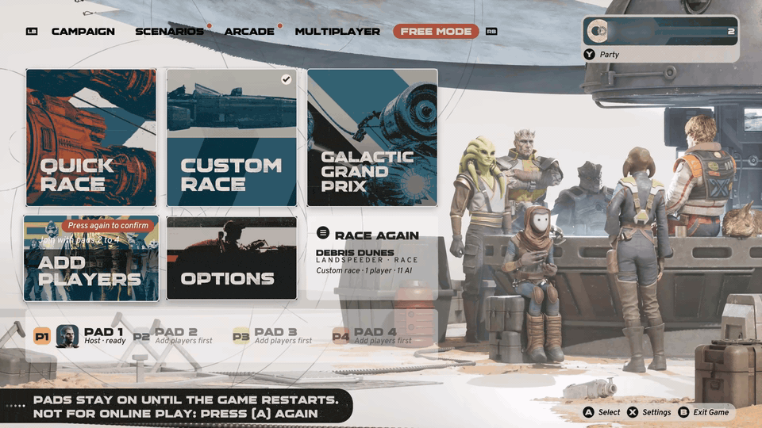 |
| **Three ways to play.** **Quick Race** gives everyone the same build. **Custom Race** uses your own builds against an AI tier you choose. **Galactic Grand Prix** is the multi-race tournament above. | **Join with A.** Turn the pads on with ADD PLAYERS, then each friend presses **A** on their own pad. Their seat lights up at once. |

<div align="center">

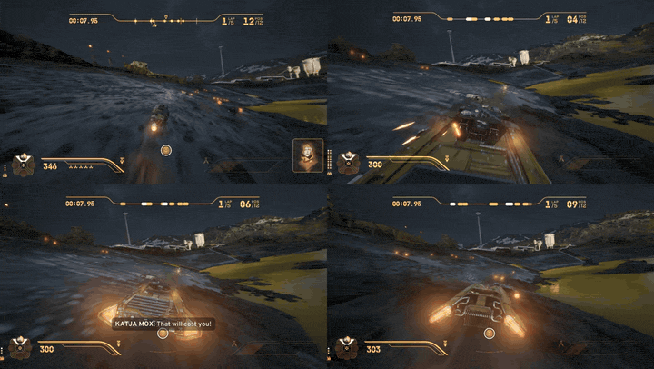

*Four players, four views. Any track, any planet and any class, podracers included. Takedowns are credited to the
right player.*

</div>

- **Every track the game offers** in Quick Race and the Arcade, with its conditions (time of day, weather) and modes
  (race, full grid, mixed class, eliminator).
- **Racer cards for everyone.** Each player picks a pilot, a vehicle (shown as a live 3D render) and a full loadout:
  abilities, parts, upgrade levels, racer style and traits. Everything is unlocked. Press **A, A, A** for a ready-made
  build. A guest's **Y** picks one at random.
- **AI you can tune.** Choose from six tiers, or *Match the players*, so a maxed group meets maxed opponents.
- **Per-player everything in the race:** HUD, boost and ramjet bars, subtitles, name tags and pause menu.
  **RESTART RACE** sits in the pause menu.

<details>
<summary><b>How to play, step by step</b></summary>

1. Main menu › **FREE MODE** (LB / RB).
2. With friends: A on **ADD PLAYERS**, then A again to confirm (the poster then reads *PADS ON*; the pads stay on
   until the game restarts). Each friend presses **A** on their own pad, and the players strip shows who joined. A
   guest leaves with **B** (on the racer cards: hold B).
3. Pick a way to play:
   - **QUICK RACE**: one difficulty for the whole race (Rookie to Legend), and the players and the AI get the same
     build. Each player only picks a pilot and a vehicle.
   - **CUSTOM RACE**: choose the class, planet, track, conditions and mode, then everyone builds their own kart on the
     racer cards (pilot › vehicle › perks › ready). *Opponents* sets the AI tier, or *Match the players*.
   - **GALACTIC GRAND PRIX**: pick a tour, set it up, and race it to the podium. Between races the page shows the
     standings and NEXT RACE.
4. P1 starts when everybody is READY. In RACE SETUP, **B** goes back one step.
5. In the race, Start pauses (the pause menu belongs to whoever pressed it; RESTART RACE is right under RESUME). On the
   results, any player's A continues.
6. **OPTIONS** holds the game's settings for the mod: see [Settings](#settings). **B**, Backspace or **BACK** returns
   to the posters. On the posters themselves, B is the game's Exit Game (see [Known limits](#known-limits)).

</details>

<br>

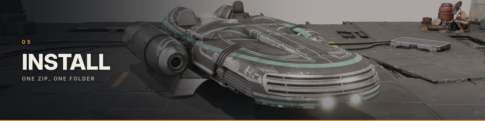

## Install

### Before you play: offline only

> **⚠ Play offline, and protect your save.**
>
> - Start Steam in **Offline Mode** (Steam menu › Go Offline) before you play with the mod, and do not use the mod for
>   online play. To start straight at the main menu, the mod turns off the game's Epic account link in your game
>   profile (as accepting the game's own "EOS linking will be disabled" prompt does), and online play may need that
>   link.
> - **Turn off Steam Cloud for the game** while you use the mod (Steam: right-click the game › Properties › General).
>   Otherwise Steam can upload the save you played with the mod, and later replace a copy you put back.
> - Keep a copy of the game's `Saved` folder from before the install (Proton:
>   `steamapps/compatdata/4078430/pfx/drive_c/users/steamuser/AppData/Local/StarWarsGalacticRacer/Saved`; Windows:
>   `%LOCALAPPDATA%\StarWarsGalacticRacer\Saved`) and **put it back before you play online again**. The game may later
>   upload race times set offline to its online leaderboards, so a save used with the mod should not go online.
>   Putting it back also restores the link setting, and your progress as it was then.
> - **The couch campaign is player 1's real campaign run.** The game keeps one run per profile, so a new couch run
>   replaces your solo run. Copy `SaveGames` first.

The game is not included. You need a legitimately bought copy (Steam). The mod contains no game code and no game
files. Its pages are drawn with the art and fonts of your installed game, and the perk menus use names and
descriptions from the game's data (`Scripts/perkdata.lua`).

### Requirements

- **STAR WARS Galactic Racer** on Steam, build CL 386500 (the 2026-10-22 update; the main menu shows `CL386500` in its
  bottom-left corner), CL 382801 or CL 382493: all are supported.
- **[UE4SS Galactic Racer Edition](https://www.nexusmods.com/starwarsgalacticracer/mods/2) by GenerousMods.** Get
  it from its page, for every download: it is kept up to date after every game update, and most UE4SS mods for this
  game use it.
- One pad per player (Xbox layout tested; DualShock through Steam Input or Moonlight works).
- Windows, or Linux / Steam Deck with Proton (tested: GE-Proton 11-7 + Steam Linux Runtime 4).

### The easy way: unzip into the game folder

Download **`SWGRCouch-1.0.2-gameroot.zip`** from the mod's **Nexus Mods** page or from the release page here. It holds
the mod and its input filter DLL, already laid out like the game folder. It does not include UE4SS.

1. **Install [UE4SS Galactic Racer Edition](https://www.nexusmods.com/starwarsgalacticracer/mods/2) first**, as its
   page says. You then have `Griffin\Binaries\Win64\dwmapi.dll` and `Griffin\Binaries\Win64\ue4ss\UE4SS.dll` next to
   `SWGR-Win64-Shipping.exe`.
2. Find the game folder, the one that contains the `Griffin` folder. In Steam: right-click the game › Manage › Browse
   local files (usually `...\steamapps\common\STAR WARS Galactic Racer\`).
3. **Extract the zip into that folder** (the folder itself, not a new subfolder named after the zip) and let it
   merge the folders; answer *replace* if asked: the zip holds only SWGRCouch's own files, never one of UE4SS or of
   another mod. You then have `SWGRCouch-INSTALL.txt` (the install notes) in the game folder and
   `Griffin\Binaries\Win64\ue4ss\Mods\SWGRCouch\` with `Scripts\` and `native\swgr_inputfilter.dll`.
4. **Windows:** done, start the game. **Linux / Steam Deck:** the game's launch options in Steam (Properties ›
   General › Launch options) must be

    ```
    WINEDLLOVERRIDES="dwmapi=n,b" %command%
    ```

    as for any UE4SS mod: without it Proton ignores `dwmapi.dll` and nothing loads.

> **Steam Deck:** extract the zip in Desktop Mode (copy it into the game folder, then Dolphin: right-click the zip ›
> Extract › Extract archive here; or Ark › Extract with "Extract into subfolder" unticked), set the launch option
> above, then go back to Gaming Mode. Pair or plug in one pad per extra
> player; the Deck's own controls are player 1.

**What the zip writes into `ue4ss\`:** only the mod folder `Mods\SWGRCouch\` (with its `README.txt` = the install
notes, and `native\swgrcouch-cert.pem`, the DLL's public certificate) and SWGRCouch's signature files in
`UE4SS_Signatures\`. It ships **no** `mods.txt`, `mods.json` or `UE4SS-settings.ini`, so your other UE4SS mods and
settings stay as they are: SWGRCouch starts through its own `Mods\SWGRCouch\enabled.txt` (UE4SS starts every mod
folder that has one, listed in `mods.txt` or not). Keep SplitScreenMod off (another split screen; UE4SS Galactic Racer
Edition ships it off). The two `UE4SS-settings.ini` values the mod needs (`bForceGUObjectArrayForIteration = true`,
`UseCache = 0`) are already set in UE4SS Galactic Racer Edition.

An all-in-one variant that also carries UE4SS Galactic Racer Edition (`SWGRCouch-1.0.2-gameroot-with-UE4SS.zip`) is
built as well; it is on the git.jules.my release page only (with GenerousMods' OK), not on Nexus: get UE4SS updates from [its own page](https://www.nexusmods.com/starwarsgalacticracer/mods/2), and please don't re-upload either.

**Updating:** quit the game, then extract the new zip the same way over the old files. Your own files are never in the
zip, so `settings.txt`, `config_user.lua`, the run and Grand Prix files and the game's saves stay.

### The lean way: the mod only

For players who would rather place the mod folder by hand. It needs UE4SS Galactic Racer Edition too.

- **Mod folder**: `SWGRCouch-1.0.2-nexus.zip`, the mod folder only (Lua scripts, no DLL, no executable). Install
  [UE4SS Galactic Racer Edition](https://www.nexusmods.com/starwarsgalacticracer/mods/2) first, then extract the zip
  into `<game>\Griffin\Binaries\Win64\ue4ss\Mods\`.
- **Optional file**: `swgr_inputfilter.dll`, into `ue4ss\Mods\SWGRCouch\native\`. It gives each player's car its own
  pad. Solo play works without it; in split screen the pads mix without it (see
  [The input filter DLL](#the-input-filter-dll)).

<details>
<summary><b>From this repository (Linux script, manual Windows steps)</b></summary>

`install.sh` works from a checkout, and the DLL can be rebuilt from its source with
`SWGRCouch/native/inputfilter/build.sh`.

**Linux / Steam Deck (Steam + Proton)**
```sh
git clone https://git.jules.my/jules/swgrcouch.git && cd swgrcouch
./install.sh "$HOME/.local/share/Steam/steamapps/common/STAR WARS Galactic Racer"
```
Then set the launch options in Steam (Properties > Launch options): `WINEDLLOVERRIDES="dwmapi=n,b" %command%`.
`install.sh` never deletes anything (edited files get a dated copy first) and keeps your `config_user.lua`,
`settings.txt` and UE4SS console setting. A first install leaves UE4SS's console windows off: add `--console` to turn
the log console and the GUI console on (for a bug report), `--quiet-console` to turn them off again.
`./install.sh --help` lists the other options. It uses the UE4SS already in the game: install UE4SS Galactic Racer
Edition from its page first. If it warns that the installed UE4SS is 3.0.1-1160, update UE4SS Galactic Racer Edition.

**Windows**

1. Open `<game>\Griffin\Binaries\Win64\` (the folder with `SWGR-Win64-Shipping.exe`).
2. Install [UE4SS Galactic Racer Edition](https://www.nexusmods.com/starwarsgalacticracer/mods/2) by GenerousMods as
   its page says (its files go into that folder).
3. Copy `SWGRCouch\` into `ue4ss\Mods\` (so you get `ue4ss\Mods\SWGRCouch\Scripts\main.lua`), replacing old files.
4. Copy the `ue4ss_signatures\*.lua` files into `ue4ss\UE4SS_Signatures\`.
5. Nothing to edit in `ue4ss\Mods\mods.txt`: `SWGRCouch\enabled.txt` starts the mod (a `SWGRCouch : 1` line there,
   above the last line `Keybinds : 1`, does the same; `install.sh` adds it).

**Updating from an older version:** install over it the same way. If your `config_user.lua` sets `CardW`, `CardGap`,
`CardH`, `CardRowW`, `SetupCMapVideoW`, `SetupCMapBackground`, `SetupCMapMapW` or `SetupCMapMapH`, remove those lines:
a value set there also replaces the new layout's own value.

</details>

### Check it works
Start the game. `Griffin/Binaries/Win64/ue4ss/UE4SS.log` shows `SWGRCouch 1.0.2 loading` and `modules=85/85`, and the
main menu has a **FREE MODE** tab with the QUICK RACE, CUSTOM RACE and GALACTIC GRAND PRIX posters. Once a second pad
joins, the log shows `native filter loaded: installed=1 reason=ok build=386500` (the number is your game build; `build=auto` means a newer
game build the filter worked out by itself).

### Uninstall

- **Turn it off:** on Windows delete or rename `dwmapi.dll` in `<game>\Griffin\Binaries\Win64\`; on Linux / Steam Deck
  remove `WINEDLLOVERRIDES="dwmapi=n,b"` from the launch options. UE4SS and the mod no longer load (the files can stay).
- **Remove it completely:** delete `Griffin\Binaries\Win64\dwmapi.dll` and the `Griffin\Binaries\Win64\ue4ss\` folder
  (this also removes other UE4SS mods you put there; to remove only SWGRCouch, delete just `ue4ss\Mods\SWGRCouch\`).
- Every file `install.sh` changed has a dated copy next to it (`*.swgrcouch-<date>`). If you ran it with `--prefix`:
  `install.sh --prefix <wine prefix> --net-off` removes the network override, and `--fastboot-ini-undo` turns the
  Epic link setting in `GameUserSettings.ini` back on.
- The Epic link setting in your game profile stays off after an uninstall. To play online again, put back the `Saved`
  folder you copied before the install, with Steam Cloud still off for the game so Steam does not replace it.

<br>

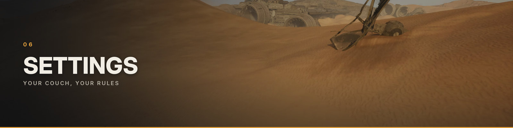

## Settings

<div align="center">

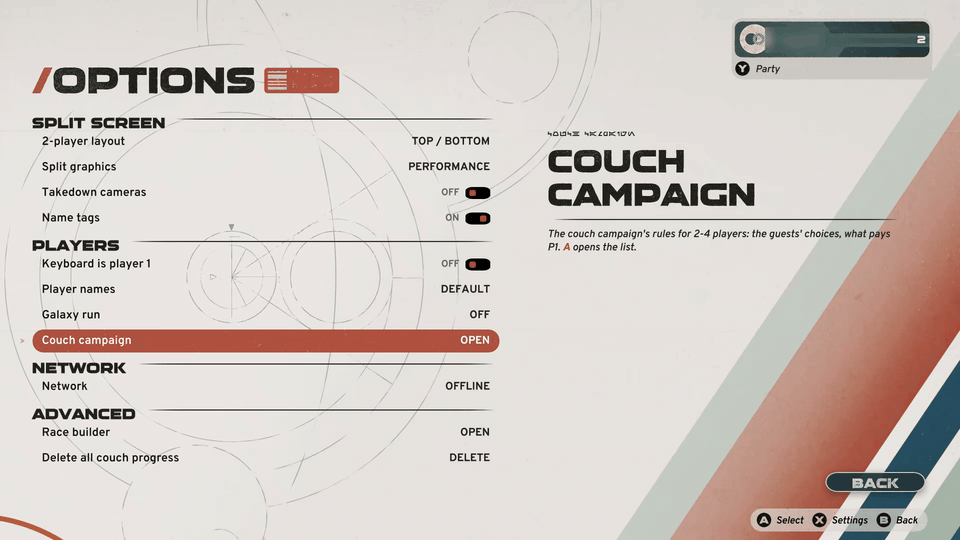

</div>

**In the game: FREE MODE › OPTIONS.** The 2-player layout (top / bottom or side by side), split graphics, takedown cameras, name tags, keyboard as player 1, player names, network, the game's race builder, and the couch campaign's **house rules**. Every change is saved at once in `ue4ss/Mods/SWGRCouch/settings.txt`.

**House rules** (OPTIONS › PLAYERS › *Couch campaign*). The right column explains each row and its default.

- *Guests' team mystery choices*: GREYED (only P1 takes a choice with a team effect) or ALLOWED (a guest may take it
  too).
- *P1's rewards*: OWN PLACE, or BEST CARRIES EVERYONE (the best human result pays P1 too).
- *Broker penalty: Eliminators*: BOTH PLAYERS or OWNER ONLY.

**Opponents** (RACE SETUP › MODE › Opponents) sets the AI tier (1 to 6) or *Match the players*. It is kept in
`settings.txt` as `OpponentTier`, with your other choices.

<details>
<summary><b>config_user.lua: the keys for tinkerers</b></summary>

Never edit `config.lua`. Create `ue4ss/Mods/SWGRCouch/Scripts/config_user.lua` instead, then restart the game:
```lua
return {
    UiStyle          = "v2",     -- "classic" brings back the 0.11 pages (FREE MODE rows, RACE SETUP frame, cards)
    BackPromptAsBack = true,     -- false: pad B on OPTIONS / RACE SETUP opens the game's QUIT GAME? prompt again
    SetupPlayerFlow  = "cards",  -- "classic" brings back the 0.9 vehicle columns instead of RACERS
    HotplugPadToP1   = "front",  -- a pad switched on later takes P1 (only if P1's pad is gone): "always" | "off"
    SkipRaceIntro    = false,    -- true skips the race intro cinematics and movies
}
```
The values above are the defaults; a line you leave out keeps its default.

- `UiStyle = "classic"` is the way back to the 0.11 pages if the new ones give you trouble; the player colours stay.
- `BackPromptAsBack = false` leaves the game's QUIT GAME? prompt on OPTIONS and RACE SETUP (the 0.11 behaviour).
- `GrandPrix = false` puts the older GALAXY RUN page back on the third poster instead of GALACTIC GRAND PRIX.
- `Debug = true` adds the log lines a bug report needs.
- **Couch campaign:** `CouchCampaign = false` turns the whole feature off (the campaign closes the friends);
  `CouchSkipPrologue`, `CouchTimeTrials`, `CouchPreRunSplit` and `CouchPanel` turn single parts off;
  `CouchSoloPrompt = false` lets the COUCH CAMPAIGN page start a run with player 1 alone;
  `CouchGarage = false` hides the friends' GARAGE, `CouchGarageApply = "off"` keeps their chosen model but not their
  livery; `CouchToastMs = 0` hides the banner; `CouchPanelNative = false` shows a friend's rewards as a plain list.

A layout key you set here (`CardW`, `CardH`, `SetupCMapVideoW`...) applies to both looks. Every key is explained in
`Scripts/config.lua`, and most of them in [docs/REFERENCE.md](docs/REFERENCE.md) §7.2; the `settings.txt` keys are in
§7.1.

</details>

<br>

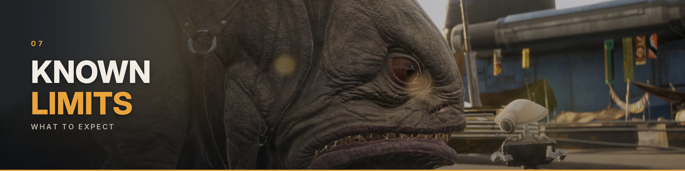

## Known limits

**Couch campaign**

- **Verified with 2 players.** 3 and 4 players run the same code and were tested less: treat them as *experimental*.
- Join the friends on FREE MODE **before** you open CAMPAIGN; nobody can join from the paddock.
- Offline only, like the rest of the mod: no couch campaign in network sessions.
- The friends have no paddock character, and the run's story choices, the run map and the save are player 1's.
- A friend's reward choice follows the kind of reward player 1's round offers (upgrade, ability, part or trait); the
  friends do not unlock anything in the game's own profile.
- Quitting the game or a crash in the middle of an event can lose the run's unsaved progress (the game saves the run
  at its own checkpoints): CONTINUE may then start a new run.

**Menus and races**

- **B on the FREE MODE posters is the game's Exit Game.** As on every main-menu tab, P1's B there opens the game's
  QUIT GAME? prompt with ACCEPT focused: choose CANCEL. Only OPTIONS, RACE SETUP and the mod's own pages turn B into
  back (`BackPromptAsBack`).
- **The action bar at the bottom is the game's.** On OPTIONS and RACE SETUP it still reads *(B) Exit Game*, and
  clicking Exit Game with the mouse there also goes back: to quit the game, return to the posters first. On TRACK it
  shows *(A) Select* twice.
- **Joining**: a guest's A press that joins can also click the poster P1's cursor is on. Most posters ignore it
  (`CardGuestClickGuardMs`, 150 ms); some OPTIONS rows and the `UiStyle = "classic"` rows do not yet.
- With two wrecked guests, both may follow the same AI car.
- Pads that are connected but not joined race as AI-driven players with their own view.
- The game pauses itself after about a minute without any game input from any player (the game's own inactivity
  pause).
- Languages other than English, German and French are only partly checked. A RACERS card text that does not fit its
  box is logged as `text overflow` in `UE4SS.log`: please report those lines with the game's language.
- After changing the game's language while it runs, restart the game: until then the RACE SETUP track names and the
  CLASS description can keep the previous language.

<br>

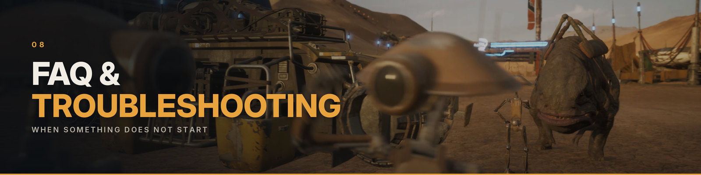

## FAQ and troubleshooting

<details>
<summary><b>There is no FREE MODE tab.</b></summary>

UE4SS did not load the mod. On Linux / Steam Deck, check the launch option `WINEDLLOVERRIDES="dwmapi=n,b" %command%`.
Then check that `Griffin\Binaries\Win64\dwmapi.dll` and `Griffin\Binaries\Win64\ue4ss\UE4SS.dll` exist (UE4SS Galactic
Racer Edition is installed) and that `ue4ss\Mods\SWGRCouch\Scripts\main.lua` is there (the zip was extracted into
the game folder, not into a folder of its own), and open `Griffin/Binaries/Win64/ue4ss/UE4SS.log`:
it should show `SWGRCouch 1.0.2 loading`.

</details>

<details>
<summary><b>Every pad steers player 1's car (or every car).</b></summary>

Look for `native filter loaded:` in `UE4SS.log`. `installed=0 reason=mismatch ...` means a game update this SWGRCouch
does not know yet (the line then says to update SWGRCouch): get the newest release. Also keep the old SplitScreenMod
off (`SplitScreenMod : 0` in `ue4ss\Mods\mods.txt`, and no `enabled.txt` in its folder): SWGRCouch warns in the log
when it is on. No `native filter loaded` line at all: the input filter DLL is missing. The lean Nexus zip ships
without it: put the optional `swgr_inputfilter.dll` into `ue4ss\Mods\SWGRCouch\native\`, or use the game-folder zip.
The log shows `native filter loaded: installed=1 reason=ok` once it works.

</details>

<details>
<summary><b>The game stopped starting after a game update.</b></summary>

A game patch can move the code UE4SS looks for. Turn the mod off (see [Uninstall](#uninstall)), update
[UE4SS Galactic Racer Edition](https://www.nexusmods.com/starwarsgalacticracer/mods/2) from its page, and look for a
new SWGRCouch release. The supported game builds are listed under [Requirements](#requirements).

</details>

<details>
<summary><b>Can I play online with it?</b></summary>

No. Play with Steam in Offline Mode and Steam Cloud off for the game, and put back your pre-mod `Saved` folder before
you play online again ([Before you play](#before-you-play-offline-only)).

</details>

<details>
<summary><b>Will the couch campaign touch my solo run?</b></summary>

Yes: the couch campaign *is* player 1's campaign run, and the game keeps one run per profile. Copy `SaveGames` before
the first couch run, and put it back when you want your solo run again.

</details>

<details>
<summary><b>The COUCH CAMPAIGN page says it needs 2 players.</b></summary>

No friend has joined yet. Have them press **A** on their pad (ADD A SECOND PLAYER keeps the page open for that), or
pick BACK TO MENU and play alone from the game's normal **CAMPAIGN**.

</details>

<details>
<summary><b>Does it work on the Steam Deck?</b></summary>

It runs through Proton like on any Linux PC: install UE4SS Galactic Racer Edition, then the game-folder zip, with
the launch option from [Install](#install). For split screen, connect one pad per extra player (Bluetooth, USB or a
dock); the Deck's own controls are player 1. A TV through a dock gives every player a bigger view.

</details>

<details>
<summary><b>Which controllers work?</b></summary>

Any pad the game sees as a controller. The Xbox layout is tested; DualShock and other pads work through Steam Input
(or Moonlight). OPTIONS can also make the keyboard player 1.

</details>

<details>
<summary><b>My virus scanner flags swgr_inputfilter.dll.</b></summary>

A heuristic false positive on a small DLL. It is built from the C source in this repository and rebuilds
byte-identical, so anyone can check it, and the 1.0.2 copy carries the author's signature (see
[The input filter DLL](#the-input-filter-dll)).

</details>

<details>
<summary><b>The game pauses on its own.</b></summary>

That is the game's own inactivity pause: about a minute without input from any player. Press Start to go on.

</details>

<br>

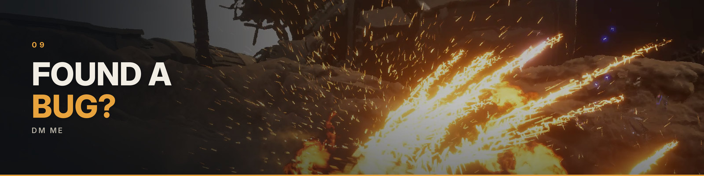

## Found a bug?

**DM me** on the site where you got the mod (Nexus Mods: a private message).

1. Set `Debug = true` in `config_user.lua` (see [Settings](#settings)).
2. Play until it happens again.
3. Send **`Griffin/Binaries/Win64/ue4ss/UE4SS.log`** (every mod line starts with `[SWGRCouch]`) plus any
   `crash_*.dmp` next to it. Say how many players you were and what was on screen.

The full list of checks with their log lines is in [docs/REFERENCE.md](docs/REFERENCE.md) §9.

<br>


## Credits

- **SWGRCouch** by Jules, **made with the help of Claude** (Anthropic). MIT licence (see `LICENSE`).
- [UE4SS Galactic Racer Edition](https://www.nexusmods.com/starwarsgalacticracer/mods/2) by **GenerousMods**: the
  UE4SS build for this game that the mod runs on. Thanks to GenerousMods for maintaining it.
- [UE4SS](https://github.com/UE4SS-RE/RE-UE4SS): MIT.
- `ue4ss_signatures/`: written for SWGRCouch (the 2026-10-12 hotfix moved the engine's allocator); they overlap with
  the signatures UE4SS Galactic Racer Edition maintains.
- The pictures and animations on this page are captures of the game running with the mod.

**Fan-made and unofficial.** SWGRCouch is not affiliated with, endorsed by or sponsored by Lucasfilm, Disney, Fuse
Games or Secret Mode. STAR WARS and STAR WARS Galactic Racer are trademarks of their respective owners. No game files
are distributed.

<details>
<summary><b>How it works (short)</b></summary>

- **Players**: guests are extra UE local players, created after ADD PLAYERS and kept until the game exits.
- **Race launch**: the game's own custom-race path, with the grid rewritten in memory. Each human's pilot and loadout
  are written over the AI tier's build and checked again in the race.
- **Couch campaign**: the campaign's grid gets the guests' cars as players; screens the game makes for one player are
  copied into each guest's own area, and boss / rival / head-to-head races run one copy per player.
- **UI**: the pages are built from the game's own textures, fonts and widgets; every focus target is an invisible game
  button under the painted look.
- **Input**: a small native DLL (`SWGRCouch/native`, source included) gives each player's car its own pad.
- **Per-player UI**: menus and messages the game makes for one player are re-routed to the right player; P1 gets the
  menus after a race.

Details in [docs/REFERENCE.md](docs/REFERENCE.md).

</details>

### The input filter DLL
`swgr_inputfilter.dll` (a small native library, ~50 KB, [source included](SWGRCouch/native/inputfilter/)) is what
gives each player's car its own pad in split screen. Without it the mod still loads and **solo play works**, but in
a split race every pad steers player 1's car.

The game-folder zip ships it in place. The lean Nexus zip and the mod-only zip ship **without the compiled DLL**,
because some download sites and virus scanners flag any zip with an unsigned DLL inside (a handful of heuristic
engines flag this one too - a false positive: the DLL rebuilds **byte-identical** from the C source in this repo with
`lld-link /timestamp`, which anyone can verify). To play split screen with those, either download
`swgr_inputfilter.dll` (the optional file) into `ue4ss/Mods/SWGRCouch/native/`, or compile it yourself:
`SWGRCouch/native/inputfilter/build.sh` rebuilds it from `inputfilter.c` and `version.rc` with the system LLVM
(`clang`, `lld-link`, `llvm-rc`, `llvm-dlltool`); no Windows SDK is needed.

**Signature (1.0.2).** The DLL in the 1.0.2 downloads is signed by the author with a **self-signed** certificate
(`CN=Jules (SWGRCouch)`): a local signature, not a CA-trusted one, so Windows still shows *unknown publisher*. It
proves the file is the one the author signed. The game-folder zips carry the certificate next to the DLL
(`native\swgrcouch-cert.pem`). The public certificate is
[docs/signing/swgrcouch-cert.pem](https://git.jules.my/jules/swgrcouch/src/branch/main/docs/signing/swgrcouch-cert.pem)
(SHA-256 fingerprint `05:FA:00:C4:E0:53:2B:0C:86:62:6A:2E:6B:1D:A6:C4:4C:62:55:97:5D:A7:2E:18:99:76:24:1A:C0:A8:1A:A7`);
check a download with `osslsigncode verify -in swgr_inputfilter.dll -CAfile swgrcouch-cert.pem`.

| 1.0.2 `swgr_inputfilter.dll` (DLL version 1.0.2.0) | sha256 |
|---|---|
| signed (in the zips and the bare download) | `ed491789b9f967b97d79553a610520f5b861a111b544c3e0d581e1cc8a0aef00` |
| unsigned reproducible build (`build.sh`, LLVM 23.1.1) | `4363c77db01d49160c23e969653861209bb611439c1f98a6931cf68e39a1e300` |

### Code signing policy
The input filter DLL is the only file this project signs, and the author's self-signed signature above is the
project's chosen approach: the author signs it by hand on his own machine (the private key never leaves it), and the
reproducible build with both hashes is the second, independent proof. What is signed, who signs, how to verify a
download and the privacy statement (the DLL makes no network connections): [CODE-SIGNING-POLICY.md](CODE-SIGNING-POLICY.md).

## One more thing: give vegan a try 🌱

Thanks for playing. If you have a minute for something bigger than a race: please consider going vegan.
Every year, tens of billions of land animals are bred, confined and killed for food. They feel fear and pain just like
the dogs and cats we love. Animal farming is also one of the biggest drivers of deforestation, water use and climate
change.

You don't have to be perfect to make a difference. Start with one meal, one week, or a free guided challenge like
[Veganuary](https://veganuary.com) or [Challenge 22](https://challenge22.com).
