# SWGRCouch: FREE MODE for STAR WARS™ Galactic Racer

A fan-made [UE4SS](https://github.com/UE4SS-RE/RE-UE4SS) Lua mod that adds a **FREE MODE** tab to the main menu:
race **any track on any planet, in any vehicle class (podracers included), in any conditions and mode**, against a full
AI grid. Play **alone or with up to 4 local players** on one screen. Every player picks their own **pilot, vehicle and
complete loadout**: abilities, parts, upgrade levels, racer style and traits, all unlocked.

> **Version 0.10.1.** Captured live on the current Steam build (CL 382493) with UE4SS Galactic Racer Edition, in a
> 1280x720 test window; account names are blurred. The game itself is not included: you need a legitimately bought
> copy (Steam). This project is not affiliated with Lucasfilm, Disney or the game's developers. It contains no game
> code and no game files; the perk menus use names and descriptions from the game's data (`Scripts/perkdata.lua`).

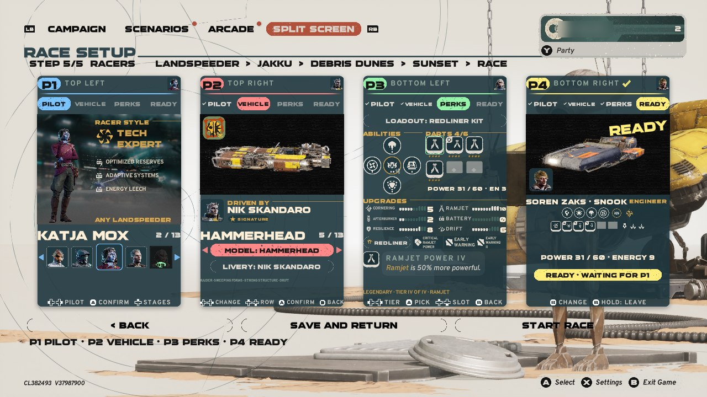

---

## Screenshots

### 1. The FREE MODE tab

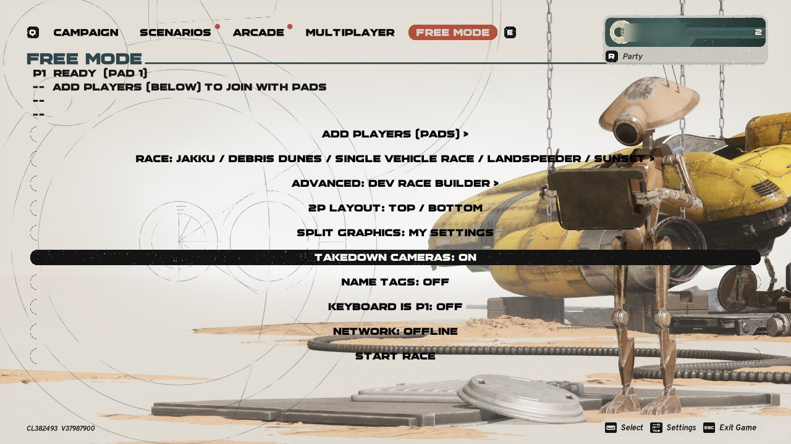

**The tab formerly called SPLIT SCREEN is now FREE MODE**, because the mod is just as much for one player: any map,
any pod, any settings. The page lists the players (P1 is always the main pad), **ADD PLAYERS** for friends' pads, the
race that START RACE will run (here *Jakku / Debris Dunes / single vehicle race / Landspeeder / Sunset*), the advanced
dev race builder and the options: 2-player layout, split graphics preset, takedown cameras, name tags, keyboard as P1,
network. This page still has the 0.10 list layout; its redesign is in progress (section 5).

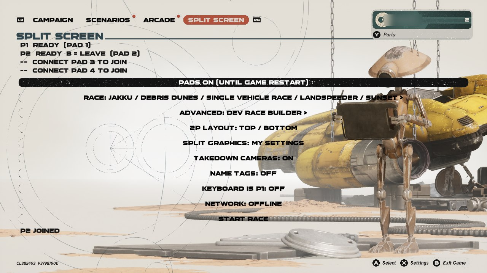

**Two players joined.** P2 pressed A on their own pad and shows as *READY, B = LEAVE (PAD 2)*; the free slots say which
pad can still join. (Captured just before the rename, so the tab still reads SPLIT SCREEN.)

### 2. Race setup (steps 1-4)

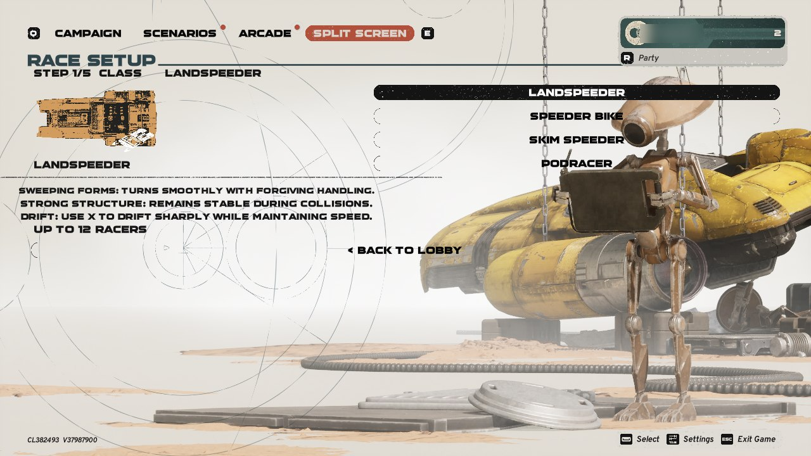

**Step 1, CLASS:** landspeeder, speeder bike, skim speeder or podracer, with the class traits from the game data.
Fixed in 0.10.1: the trait texts used to show the game's raw markup (`USE <ACTION ID="IMPROVEDSTEERING"/> TO DRIFT`);
they now read *DRIFT: USE X TO DRIFT SHARPLY WHILE MAINTAINING SPEED*.

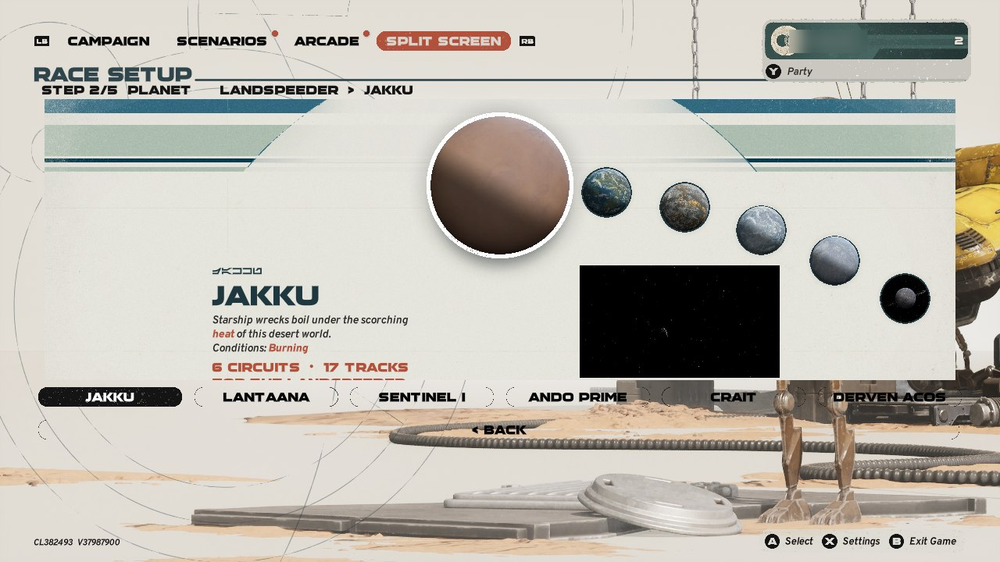

**Step 2, PLANET:** the campaign's own planet carousel with the planet's description and its circuit and track count
(*6 circuits, 17 tracks* on Jakku). The black box is the planet video that did not start in the test window (being
looked at with the redesign).

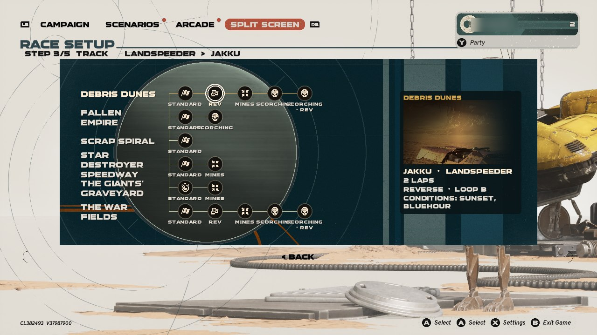

**Step 3, TRACK:** the game's own run map of the planet: one row per circuit, one node per variant (standard,
reverse, mines, scorching...), and a preview with laps, direction and the conditions the game offers for that track.
Only the tracks the game itself offers in Quick Race and the Arcade are listed: no debug, prologue or campaign copies.

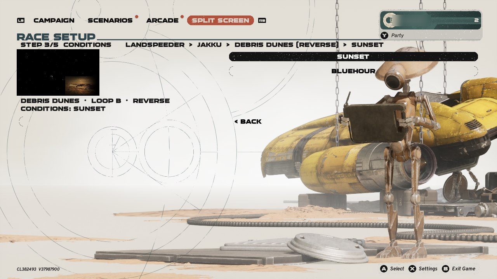

**CONDITIONS:** the time of day / weather variants the game has for the chosen track (here *Sunset* and *Bluehour*).

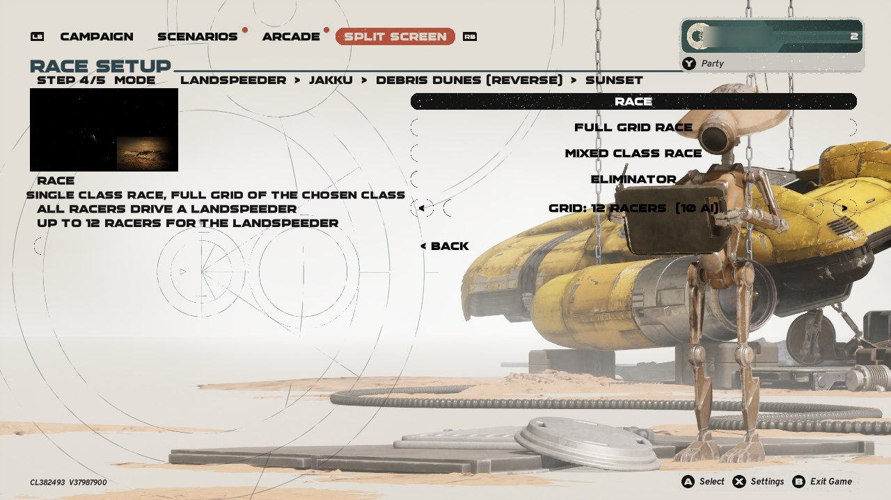

**Step 4, MODE:** race, full grid race, mixed class race or eliminator, and the grid size (*12 racers, 10 AI* here:
up to 12 speeders or 8 pods).

### 3. RACERS: pilot, then vehicle, then perks (step 5)

Every player gets **the same card** and moves through **PILOT → VEHICLE → PERKS → READY** with their own pad:
D-pad up/down = row, left/right = change (on the stage strip: switch stage), A = next or open a picker, B = back
(a guest holds B to leave). **A, A, A** from a fresh card is the quick path to READY with the pilot's signature vehicle
and style kit. Picks are remembered per pad and come back after a restart.

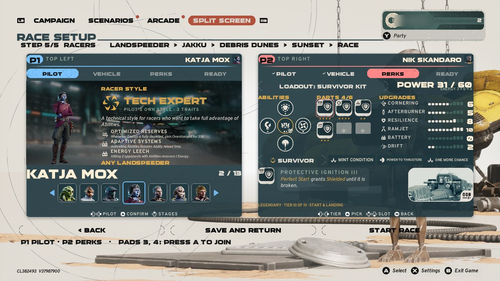

**PILOT (left) and PERKS (right).** P1 browses pilots: the full-body art over the racer style's artwork, the style
(*Tech Expert*: "a technical style for racers who want to take full advantage of abilities") with its three traits,
the signature vehicle (*any landspeeder* for Katja Mox) and the roster of heads; a pilot another player holds is
dimmed with that player's tag. P2's **PERKS** board shows the whole kart at once: the loadout kit (*Survivor kit*),
**POWER 31 / 60** and ENERGY, the four d-pad abilities laid out like the race HUD with the crash ability in the
middle, 4 of 6 part slots with their tier pips, the six upgrade bars (cornering, afterburner, resilience, ramjet,
battery, drift) at their levels, the racer style with its traits, and the game's own description card for the
selected part (*Protective Ignition III: perfect start grants Shielded until it is broken*).

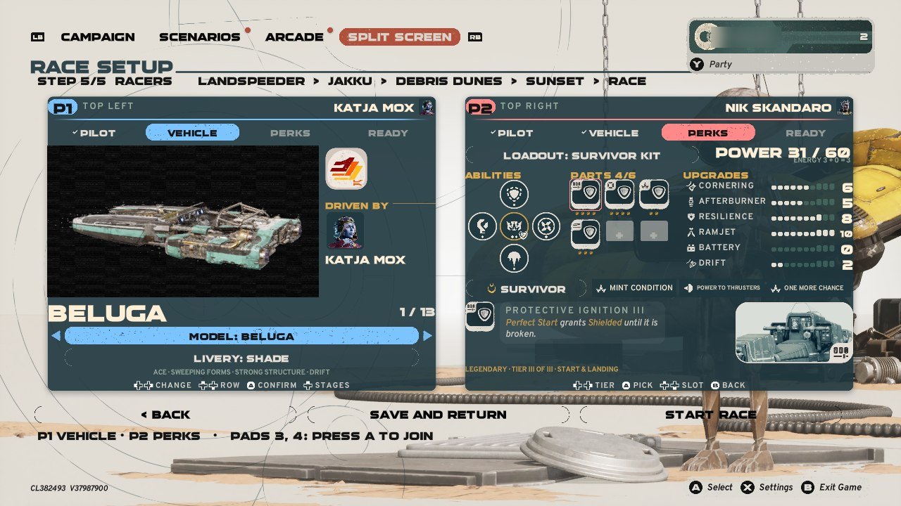

**VEHICLE:** a live 3D render of the pick (it turns on this stage), the manufacturer badge, DRIVEN BY with the pilot's
head, and the MODEL and LIVERY rows (*Beluga*, livery *Shade*), plus the class traits underneath.

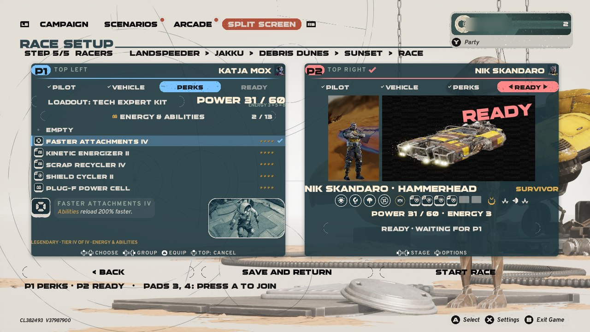

**Pickers and READY.** A on a perk slot opens a picker by category (*Energy & abilities, 2 / 13*) with tier pips, the
equipped part ticked and its description; equipping something else turns the kit into *CUSTOM, FROM TECH EXPERT*.
P2's **READY** card: the pilot, a still render with the READY stamp in the player colour, the complete loadout as one
strip of icons, POWER / ENERGY and *READY, WAITING FOR P1*.

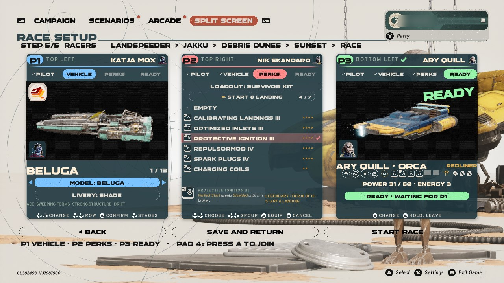

**Three players on three different stages** (vehicle, parts picker, ready). The cards shrink as a set so nothing is
cut off.


**Four players, one per stage:** pilot, vehicle, perks and ready side by side. The status line under the cards always
says where everybody is.

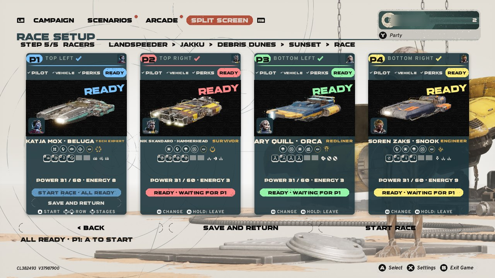

**Everybody ready.** P1's card offers **START RACE, ALL READY** (and SAVE AND RETURN); the guests wait for P1.

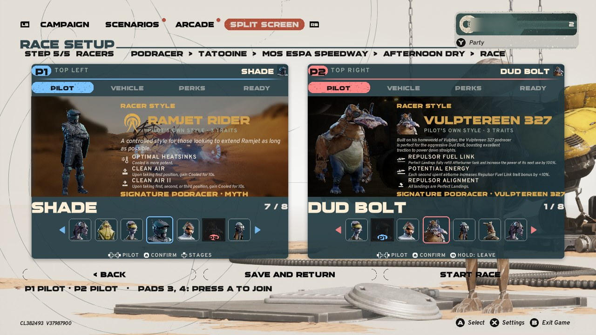

**Podracers (Tatooine):** the eight pod pilots, each with their own pod style (*Vulptereen 327* for Dud Bolt, with his
traits Repulsor Fuel Link, Potential Energy, Repulsor Alignment) and signature pod.

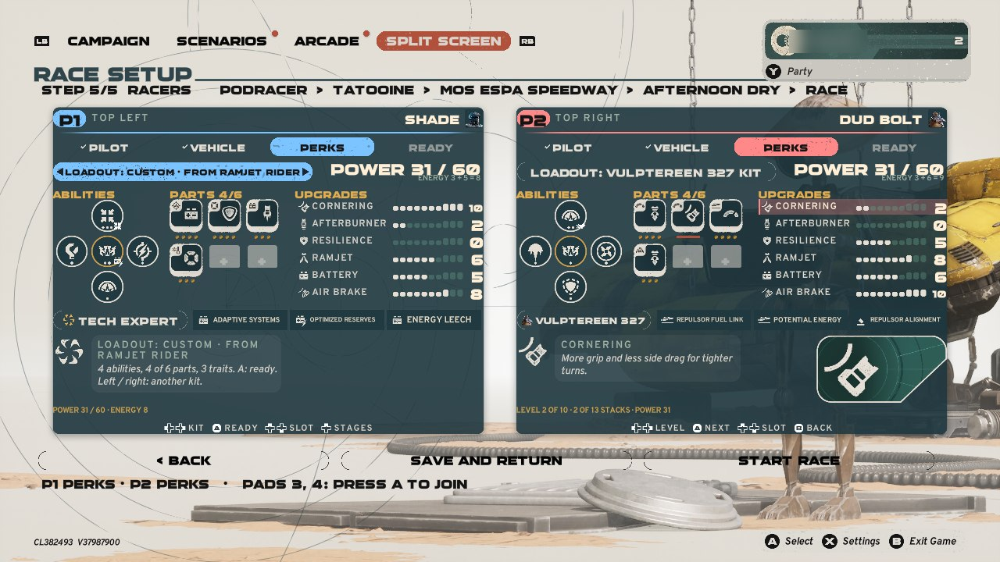

**Pod perks:** the sixth upgrade is AIR BRAKE for pods, and the pod kits load like the speeder kits. Items that need
a ramjet are hidden for pods, which have none.

### 4. In the race

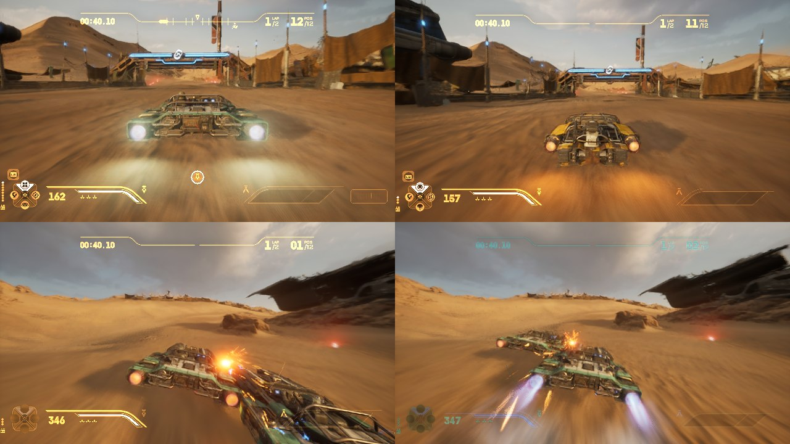

**Each player races exactly what they picked:** pilot, vehicle, upgrade levels, abilities, crash ability and parts are
written into that player's build when the race launches, the traits are applied at the start, and everything is
checked again in the race. Each view's ability cluster (bottom left) shows that player's own abilities. (The two lower
views are test pads that were connected but never joined: they race as AI-driven players. START asks twice when that
would happen.)

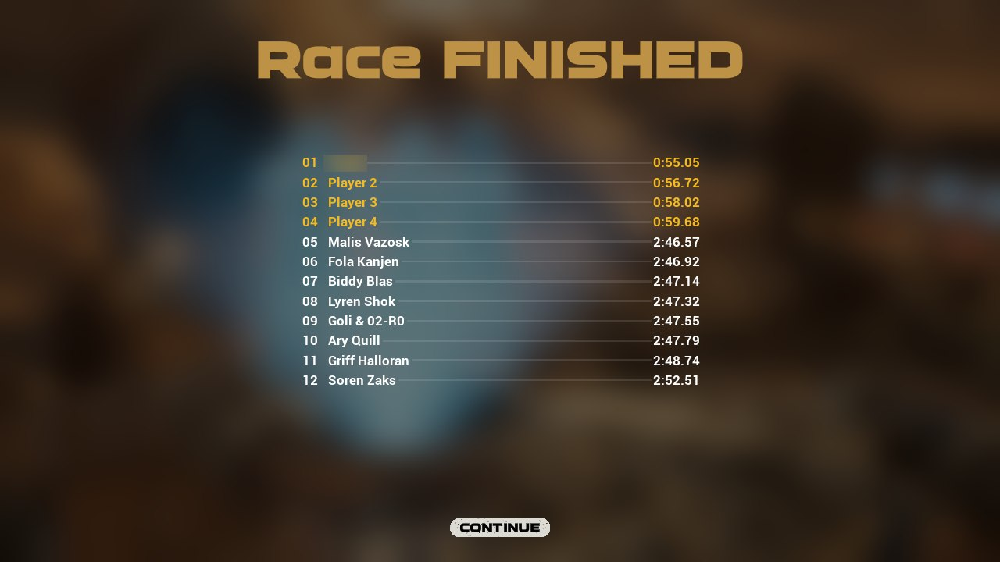

**Results.** No AI racer uses a human's pilot any more: an AI that had your pilot gets another one, with its own car
**and its own name** (earlier builds still showed the old name for that AI). **P1 can now press CONTINUE on this screen**: the
game gives it to the last local player, so P1's pad used to do nothing here.

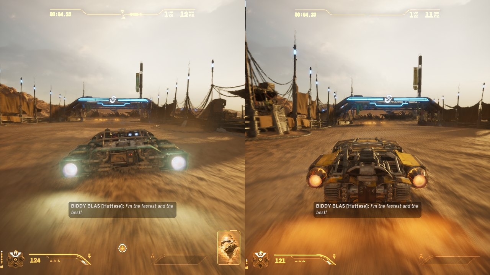

**Being fixed: the HUD in half-width views.** With two players side by side (and in the 3- and 4-player views), the
top bar with the timer, lap and position is shrunk to fit the narrow view and becomes hard to read on a TV. The fix
keeps these readable (timer pinned left, lap and position pinned right, at full size) and is being tested.

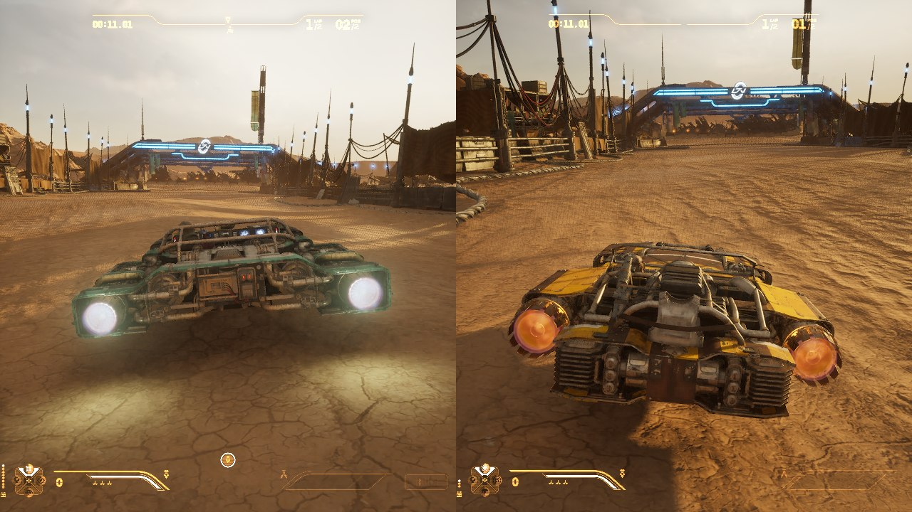

**Coming: RESTART RACE in the pause menu.** The game has its own restart call; triggered here from a running race, it
goes straight back to the start of the same race (same track, same grid, every player's loadout checked again: this
shot is the restarted race's start). The pause-menu entry is being added.

### 5. Coming next

A visual redesign of the FREE MODE page, the race setup and the RACERS cards toward the look of the game's own
menus (character select, vehicle select, the Multiplayer tab's poster tiles), RESTART RACE in the pause menu, and
a readable HUD in half-width views.

---

## What's new since 0.9.3

- **FREE MODE**: the SPLIT SCREEN tab is renamed (the mod works for one player too).
- **RACERS step**: pilot, then vehicle, then perks, then ready, one identical card per player; all perks unlocked
  (45 abilities in 8 families + the crash ability, 316 parts in 12 categories, 41 traits, 21 racer styles, 27 kits,
  six upgrade levels); picks saved per pad.
- **In the race**: each human's pilot, vehicle and loadout are applied and verified; AI racers never share a human's
  pilot (car and name included).
- **P1 owns the menus after a race**: the main menu and Settings used to belong to the last guest after a split race.
- **P1 can continue the results screen** (an invisible button with P1's focus catches P1's A).
- **Crash fix**: keyboard keys could crash the game (UE4SS runs keybinds on another thread); keys are now queued and
  run on the game thread. Verified with 160 rapid key presses.
- **Game tracks only**: the race setup lists what the game itself offers (no debug, prologue or campaign copies).
- **Both game builds**: the native input filter recognises the launch build and the October hotfix. With 0.9.3 on the
  updated game the filter did not install, so **both cars obeyed pad 1**; this fixes it.
- CLASS step trait texts no longer show raw markup; the installer keeps your UE4SS console setting on a re-install.

**Coming next:** the HUD in half-width views, RESTART RACE in the pause menu, and the visual redesign (section 5).

## Status: tested live

| Feature | 1 player | 2 players | 3 players | 4 players |
|---|---|---|---|---|
| FREE MODE tab, race setup, game-only tracks | ✅ | ✅ | ✅ | ✅ |
| RACERS step (pilot, vehicle, perks, pickers, ready) | ✅ | ✅ | ✅ | ✅ |
| Loadouts applied and verified in the race | ✅ | ✅ | — | — |
| Each pad drives only its own car (input filter, current game build) | — | ✅ | ✅ (0.9) | — |
| P1 owns the menus after a race; P1 continues the results | — | ✅ | — | — |
| Keyboard keys (crash fix) | ✅ | ✅ | — | — |
| Podracers in the RACERS step | ✅ | ✅ | — | — |
| A full podrace with loadouts, network races | not tested yet | | | |

## Requirements
- **STAR WARS Galactic Racer** on Steam, build CL 382493 (the October 2026 hotfix) or the launch build CL 381121.
- **UE4SS Galactic Racer Edition** (open beta, 2026-10-08).
- One pad per player (Xbox layout tested; DualShock through Steam Input or Moonlight works).
- Windows, or Linux / Steam Deck with Proton (tested: GE-Proton 11-7 + Steam Linux Runtime 4).

## Install

Download the latest release from the **Releases** page:
- `SWGRCouch-0.10.1-with-UE4SS.zip`: mod + UE4SS Galactic Racer Edition (open beta, 2026-10-08) (easiest);
- `SWGRCouch-0.10.1.zip`: mod only, if you already have that UE4SS build.

### Linux / Steam Deck (Steam + Proton)
```sh
unzip SWGRCouch-0.10.1-with-UE4SS.zip && cd SWGRCouch-0.10.1-with-UE4SS
./install.sh "$HOME/.local/share/Steam/steamapps/common/STAR WARS Galactic Racer"
```
Then set the launch options in Steam (Properties > Launch options): `WINEDLLOVERRIDES="dwmapi=n,b" %command%`.
`install.sh` never deletes anything (edited files get a dated copy first) and keeps your `config_user.lua`,
`settings.txt` and UE4SS console setting. `./install.sh --help` lists the options.

### Windows
1. Open `<game>\Griffin\Binaries\Win64\` (the folder with `SWGR-Win64-Shipping.exe`).
2. With the with-UE4SS zip: copy `ue4ss-build\dwmapi.dll` and the `ue4ss-build\ue4ss\` folder there.
3. Copy `SWGRCouch\` into `ue4ss\Mods\` (so you get `ue4ss\Mods\SWGRCouch\Scripts\main.lua`), replacing old files.
4. Copy the `ue4ss_signatures\*.lua` files into `ue4ss\UE4SS_Signatures\`.
5. `ue4ss\Mods\mods.txt` must contain the line `SWGRCouch : 1`.

**Updating from 0.9.3:** install over it the same way. 0.9.3 on the current game build let one pad drive every car;
0.10.1 fixes that.

### Check it works
Start the game. `Griffin\Binaries\Win64\ue4ss\UE4SS.log` shows `SWGRCouch 0.10.1 loading` and
`modules=42/42`, and the main menu has a **FREE MODE** tab. In a race with two pads, the log shows
`native filter loaded: installed=1 reason=ok build=382493`.

## Play
1. Main menu > **FREE MODE** (LB / RB).
2. Alone: **START RACE**, or **RACE: ...** to choose the class, planet, track, conditions and mode.
3. With friends: **ADD PLAYERS**, then each friend presses **A** on their own pad.
4. In RACERS, everybody picks pilot, vehicle and perks; P1 starts when everybody is READY.
5. In the race, Start pauses (the pause menu belongs to whoever pressed it). On the results, any player's A continues.

## Test it (and report)
1. Boot: FREE MODE tab, `modules=42/42`.
2. Solo race of each class; then 2-4 players.
3. RACERS: change pilot, vehicle, perks with every pad; quick path A, A, A; START.
4. In the race: your own abilities in your own HUD; every pad drives only its own car; pause from P1 and a guest.
5. Results: P1 presses A; back in the menu, P1's pad drives the menu and Settings.
6. Keyboard: arrows and Enter in the FREE MODE page and in RACERS.

When reporting, attach **`Griffin/Binaries/Win64/ue4ss/UE4SS.log`** (every mod line starts with `[SWGRCouch]`) and any
`crash_*.dmp` next to it. The full list of checks with their log lines is [docs/REFERENCE.md](docs/REFERENCE.md) §9.

## Configuration
Never edit `config.lua`. Create `ue4ss/Mods/SWGRCouch/Scripts/config_user.lua` instead:
```lua
return {
    SetupCampaignMap = true,     -- campaign-style planet carousel and run map (default true since 0.10)
    SetupPlayerFlow  = "cards",  -- "classic" brings back the 0.9 vehicle columns instead of RACERS
    HotplugPadToP1   = "off",    -- a pad connected later takes P1 ("front" | "always" | "off")
    SkipRaceIntro    = true,     -- skip the race intro cinematics
}
```
Every key is listed and explained in [docs/REFERENCE.md](docs/REFERENCE.md) §7.2 and in `Scripts/config.lua`.

## Known issues
- **P1 crashes out while others race**: P1's view can stay on a frozen crash camera instead of following a racer.
- **Joining**: a guest's A press that joins can also click the row P1's cursor is on in the FREE MODE page.
- With two wrecked guests, both may follow the same AI car.
- Pads that are connected but not joined race as AI-driven players with their own view.
- The game pauses itself after about a minute without any game input from any player (the game's own inactivity
  pause).

## How it works (short)
- **Players**: guests are extra UE local players, created after ADD PLAYERS and kept until the game exits.
- **Race launch**: the game's own custom-race path, with the grid rewritten in memory; each human's pilot and loadout
  are written into the launch build and checked again in the race.
- **UI**: the game's own widgets, created from Lua; the RACERS cards are drawn by `cards.lua` from per-player view
  models built by `racers.lua`.
- **Input**: a small native DLL (`SWGRCouch/native`, source included) gives each player's car its own pad.
- **Per-player UI**: menus and messages the game makes for one player are re-routed to the right player; P1 gets the
  menus after a race (`feowner.lua`) and a catcher button on screens another player owns (`menubridge.lua`).

Details in [docs/REFERENCE.md](docs/REFERENCE.md).

## Build the native filter (optional)
`SWGRCouch/native/inputfilter/build.sh` (mingw-w64) rebuilds `swgr_inputfilter.dll` from `inputfilter.c`.

## Credits and licences
- SWGRCouch: MIT (see `LICENSE`).
- [UE4SS](https://github.com/UE4SS-RE/RE-UE4SS): MIT.
- STAR WARS and STAR WARS Galactic Racer are trademarks of their respective owners. No game files are distributed.
